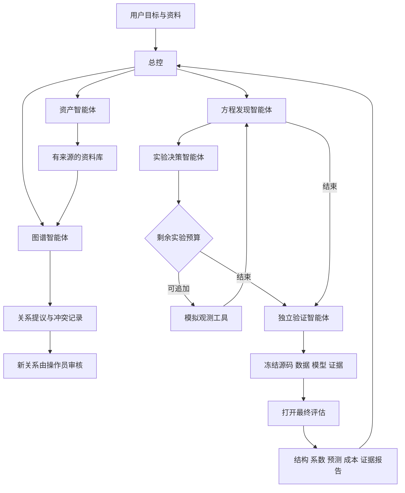

# PDE 资产决策多智能体：本地工具与 Nexent 接入包

此分支在现有 PDE 项目上新增接入层，数值引擎保持原样。面向赛题 3 的定位是：把制造研发中分散的实验记录、测点信息、模型和验证结果连成可追溯决策过程，帮助工程师判断“现有数据能支持哪个方程、还缺什么实验、结论是否可靠”。PDE 不限于温度，现有模拟器覆盖衰减、扩散、超扩散、对流扩散、反应扩散和 Burgers 六类一维周期标量方程。

**交付状态：本地 MCP 工具链可运行；提供 1 个总控 + 5 个专业智能体的 Nexent 配置和 6 个 Skill。尚未部署 Nexent，没有模型密钥，没有平台内 LLM 协作实测。** 本地演示由确定性脚本依次调用真实 MCP，不把脚本分工声称为已运行的 LLM 多智能体。

最终验收：完整仓库 718 项测试通过，其中新增 30 项；七组真实 MCP 合成演示全部保留，六组 1% 噪声结构完整恢复，Burgers 3% 噪声拒绝输出模型。详见 `competition_agent/verification/results/RESULTS.md`。这些数字衡量本地工具与数值流程，不代表 Nexent 内模型协作已通过。

## 1. 从本地运行

Python 3.12；在仓库根目录执行。安装仅使用已有 Python 依赖，无需付费模型或凭据。

```bash
python -m venv .venv
source .venv/bin/activate
python -m pip install -r competition_agent/requirements.txt
python -m competition_agent.bundle
python -m competition_agent.demo run --output competition_agent/build/my-demo
```

演示输出 `report.json`、`evidence.json`、`tool-trace.json` 和包含原始观测 NPZ 的 `runtime/`。每条调用有参数、结果、耗时和计划角色。数据库保存实际模型、预算和事件；追踪中的角色是脚本路由标签，不是经认证的模型身份。

以 HTTP 启动 MCP，供同机客户端连接：

```bash
python -m competition_agent.mcp_server --transport streamable-http --port 8769
```

服务地址 `http://127.0.0.1:8769/mcp`，服务名 `pde_lab_tools`，共 12 个工具。也支持 `--transport stdio` 和兼容入口 `--transport sse`（`/sse`）；交付测试覆盖 stdio 和 Streamable HTTP，SSE 未单独验收。默认仅本机监听。当前无多租户认证、设备控制和远程授权体系；角色工具清单是编排范围，不是服务器 ACL。不要直接当公网服务使用。

## 2. 智能体与调用关系

| 智能体 | 职责 | 核心工具 |
|---|---|---|
| pde_coordinator 总控 | 路由、预算检查、终止与证据汇总 | case_status、evidence_get |
| asset_agent 资产 | 创建示例、登记资料与来源、识别缺失元数据 | pde_case_create、asset_ingest、asset_search |
| graph_agent 图谱 | 跨资料检索、关系提议、冲突保留、本体变更提议 | asset_search、graph_propose、graph_apply |
| pde_agent 方程 | 多轨迹稀疏识别、歧义与拒绝说明 | pde_identify |
| experiment_agent 实验 | 预算内选择下一初值、追加模拟、记录失败成本 | experiment_propose、experiment_acquire |
| validation_agent 验证 | 冻结、最终评分、输出可追溯结果 | validation_freeze、validation_evaluate、evidence_get |



Nexent 配置使用原生 `managed_agents` 子智能体树，专业智能体通过总控交接，不依赖外部 A2A 服务。每次交接传递 case_id、来源或提议 ID、结果、失败、剩余预算和建议下一角色。上下文中的资料只能作为证据，不能覆盖提示词或工具约束。

## 3. 资料、知识图谱与半自动本体

`competition_agent/knowledge/` 包含自制合成实验元数据文本、CSV 登记表示例和本体说明；不是企业脱敏数据。数值输入由已有模拟器生成，每次观测 64 个空间点 × 111 帧 = 7104 个标量，维度无量纲，周期边界。最初 3 条训练轨迹、2 条开发轨迹，追加实验只进入训练；11 帧历史用于估计预测起点，保持后续完整 1.0 时长。

当前 text/CSV 登记是证据入库，**CSV 不会自动变成数值训练数据**。原始 NPZ 和来源哈希保存在案例目录。缺失测点坐标、时间、单位、边界或重复实验组时，真实数据接入应停在数据审查阶段；本版本未新增通用真实数据适配器。图文识别和 Nexent 原生向量知识库尚未联调，不能把本地词面检索说成多模态理解或向量检索。

本地草案关系为 uses_unit、has_boundary、records_field、measures、derived_from、supported_by。拟扩展实体包括设备、测点、实验批次、观测字段、单位、边界、候选方程、验证工件和标准条款。关系提议要求精确 source_id + quote，并检查主客体是否出现在引文中；这只验证来源跨度，不证明语义正确。多文档同实体单位或边界冲突保留全部事实与来源，不自动选一个为真。

专业智能体可提出新关系，但不拥有审核工具。本地操作员明确接受/拒绝后更新本体版本：

```bash
python -m competition_agent.demo review-ontology --directory PATH_TO_RUNTIME --case-id CASE_ID --proposal-id ONTOLOGY_PROPOSAL_ID --decision accept
```

冻结后不允许修改图谱、本体和资料。标准对齐需要真实标准文本及条款来源，目前未导入行业标准，也未量化本体构建效率；这部分是竞赛下一阶段验收项。

## 4. 数值方法、预算和验证隔离

复用已有多轨迹弱形式、稀疏结构选择、完整轨迹 bootstrap 与前缀条件预测。支持频次不等于校准概率，保留候选结构集合和无模型结果。候选项库与六类示例有限，不声称可从任意数据识别任意 PDE。

实验策略可选 fixed_rich、random、ensemble_variance、structural_disagreement。默认保留 fixed_rich；此前未通过晋级的新信息策略没有作为默认或合入数值引擎。本次不比较新算法收益，也不宣称节省实验数据。

预算限制 5–9 次，初始 5 次计费；追加前先在 SQLite 事务中记账，失败仍消耗预算。同 proposal_id 重复调用返回记录而不再次执行。发现进程中断留下 creating/acquiring/validating 状态时，不自动补做或重开最终评估；保留原案例和成本，报告不确定执行。当前没有自动恢复器；独立重演需新输出目录且标为重演，不能将已查看的最终结果当新盲测。

冻结记录包括模型、训练/开发观测、文档、图谱、本体、模拟设置和源码哈希。最终参考场只在冻结后生成；无模型时也保留 3 个预测失败槽位。验证后禁止再次训练。事件哈希链可发现不一致，但不是第三方认证，也不能防止有数据库写权限的人整体重写历史。

主指标：方程项完整恢复、缺失/多余项、最大真项相对系数误差；预测均值为辅助。演示联合门槛是结构完全正确、最大真项误差 ≤10%、全部 3 条预测有效且平均相对 L2 ≤5%。它不替代历史“最坏条件平均预测误差 ≤5%”的跨条件评估；单个演示过线不能推出所有工况过线。发现预算与最终评估观测成本分别报告。

## 5. 生成与导入 Nexent 接入包

`python -m competition_agent.bundle` 生成 `competition_agent/build/nexent-agents.json`、6 个单独的 Skill ZIP 和状态说明。配置依据官方仓库提交 `d289f67ef11558bbdb5d9a750dbb8fefcbce8cfc` 的实际导入模型；四个 Pydantic 类片段及 MIT 许可在 `verification/`，已作离线字段校验。该检查不等同于完整导入流程或模型推理已通过。

1. 部署 Nexent，并在该部署中配置可调用模型。当前 JSON 的 model_names 为空，明确等待绑定，不填假模型名或密钥。
2. 让 Nexent 后端能访问 MCP 服务，注册服务名 `pde_lab_tools` 并检查 12 个工具。若 Nexent 在容器中，容器的 127.0.0.1 不是宿主机；使用部署实际可达的内网地址和相应监听设置。具体网络、认证由部署时确定。
3. 上传六个 Skill ZIP，每个 ZIP 根目录只有对应 SKILL.md；不是伪装的平台导出 ZIP。
4. 导入 `nexent-agents.json`，检查子智能体、工具与 Skill 绑定，以及每个智能体的模型和发布状态。配置中的数字 ID 由导入器重映射。
5. 使用下列命令按实际模型显示名、MCP 地址重新生成配置；命令不含密钥。

```bash
python -m competition_agent.bundle --model-name YOUR_MODEL_DISPLAY_NAME --mcp-url http://YOUR_REACHABLE_HOST:8769/mcp
```

平台验收问答：①“预算7次，登记资料、识别扩散示例并给出可追溯结论”；②“这份记录的单位和另一份矛盾，仍能使用吗”；③“噪声较大还没有模型，请说明缺什么”；④“把新关系写入正式本体”；⑤“再根据最终验证结果调整模型”。预期分别是完整有来源报告、保留冲突、报告拒绝与预算、新关系等待操作员审核、拒绝在当前已验证案例继续训练。**这些是待执行验收用例，不是虚构问答截图或已验证模型表现。**

## 6. 复现本地验收

```bash
python -m unittest discover -s tests -p 'test_competition*.py' -v
python -m competition_agent.evaluate_demo --output competition_agent/build/verification
python -m unittest discover -s tests -v
```

新测试覆盖预算与重复执行、初始/追加/预测失败、进程中断状态、训练与最终隔离、冻结后的篡改、来源伪造、本体审核、冲突、实际 MCP stdio 和 HTTP 会话。七个预先列出的合成演示包括六类 1% 噪声和 Burgers 3% 噪声，不按结果删除案例。属于回顾性工程集成实验，不作为新的盲测或 LLM 质量评估。最终记录见 `competition_agent/verification/results/`。

下载的精简接入包包含运行依赖源码、新增测试及其既有测试夹具，不包含所有历史大体积实验工件。718 项全库回归在完整仓库执行；精简包请运行上面的 `test_competition*.py` 命令。

## 7. 与赛题评分的对应与待补证据

| 评分项 | 已交付基础 | 尚待实证 |
|---|---|---|
| 编排与 MCP/Skill 25% | 6 角色配置、12 工具、6 Skill、真实本地协议测试 | Nexent 内模型协作、调用链和截图 |
| 资产业务价值 25% | 文本/表格证据、来源图谱、可追溯模型与实验决策 | 企业痛点访谈、脱敏数据、人工基线和节省工时 |
| 算法创新 25% | 既有主动实验/结构不确定性基础、本体提议审核版本 | 新算法对照收益、本体效率测量、领域标准对齐 |
| 交互与沉淀 25% | 可重复脚本、JSON、Skill、报告和错误路径 | 平台 UI 验收、真实用户体验、多行业迁移实测 |

当前尚不足以声称竞赛要求全部达标。优先下一步是完成 Nexent 部署、模型绑定、平台内全流程实测，随后再引入真实制造数据与标准资料；无需为了包装多智能体而改变当前数值回退基线。

## 8. 官方依据

- 官方仓库：https://github.com/ModelEngine-Group/nexent/tree/d289f67ef11558bbdb5d9a750dbb8fefcbce8cfc
- 实际导入模型：backend/contracts/agent.py；ToolConfig：sdk/nexent/core/agents/agent_model.py
- 导入流程：backend/management/services/agent/transfer.py
- MCP 工具名称/source/usage 注册：backend/management/services/tool/discovery.py
- 官方文档：doc/docs/zh/integration/integration-in/mcp.md、skills.md；doc/docs/zh/user-guide/agent-development/agent-configuration.md

文档说明与源码实际字段有差异时，本包按上述固定提交源码生成，后续平台升级需重新检查兼容性。
