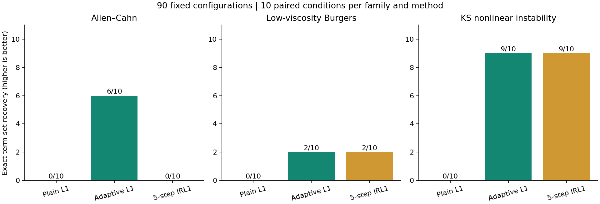
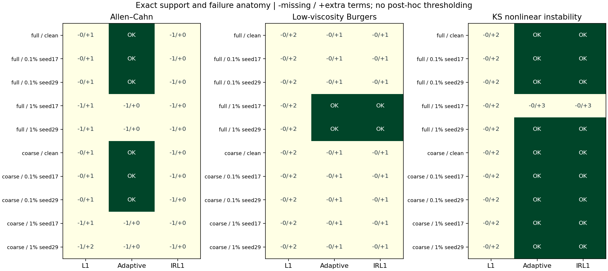
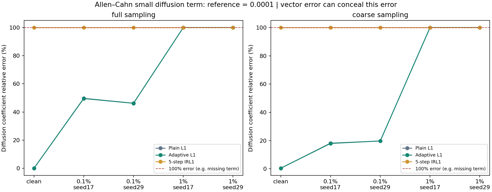

# 更具挑战性的 PDE 积分识别：噪声、粗采样与非线性动力学

本轮在独立工作树 `experiment/l1-challenge` 完成 **90 个预先固定配置** 的训练、开发选模、全局冻结和一次最终评分。一次自适应 L1 的严格项集合恢复为 **17/30**，优于普通 L1 的 **0/30**；五轮 IRL1 为 **11/30**。但预先指定的自适应方法仍有两项系数精度门槛未通过，因此**本轮不合入，继续保留原默认基线**。195 项程序测试通过不能抵消这两个科学验收失败。

这次增加难度后出现了上一轮简单解析套件未暴露的问题：粗采样会造成系数偏差；小扩散项可能被加权筛选删除，或在“结构完整、总体系数误差很小”时仍估错近一半。全部失败、微小额外项和辅助预测误差均保留，没有在看到最终成绩后删项、改阈值或换候选。

## 主结果

一个方法有3个方程族 × 2种采样 × 5种噪声条件，共30个配置。精确恢复要求参考项全部保留且没有任何多余项；保留的小系数也计为额外项。

| 方法 | 精确项集合恢复 | 多余项总数 | 漏项总数 | 最终推进失败数 |
|---|---:|---:|---:|---:|
| 普通 L1 | 0/30 | 51 | 4 | 0 |
| 一次自适应 L1 | 17/30 | 11 | 4 | 0 |
| 五轮 IRL1 | 11/30 | 11 | 10 | 0 |

| 方程族 | 普通 L1 | 一次自适应 L1 | 五轮 IRL1 |
|---|---:|---:|---:|
| Allen–Cahn | 0/10 | 6/10 | 0/10 |
| 低黏度 Burgers | 0/10 | 2/10 | 2/10 |
| KS 不稳定动力学 | 0/10 | 9/10 | 9/10 |

普通 L1 的0/30不能解释为30个模型都毫无预测价值。例如完整、无噪 Allen–Cahn 的方程为：

```text
u_t = 5.00000026*u + 3.714751355e-08*u^2
      -5.000000199*u^3 + 0.0001000043244*u_xx
```

这里仅因额外保留约 `3.71e-8*u²` 而严格结构失败；其系数向量误差约 `0.00000465431%`、最终干净场预测相对误差约 `0.00197036%`。按本轮固定规则不能事后删除它。另一方面，低黏度 Burgers 的普通 L1 存在更明显的额外衰减项与四阶项，不能把所有失败都解释为舍入误差。



## 按采样和噪声分层

下表每格依次为“精确恢复 / 3；多余项合计；漏项合计”，覆盖全部90个配置。

| 采样 | 噪声条件 | 普通 L1 | 一次自适应 L1 | 五轮 IRL1 |
|---|---|---|---|---|
| 完整 | 无噪声 | 0/3；5；0 | 2/3；1；0 | 1/3；1；1 |
| 完整 | 0.1%，种子17 | 0/3；5；0 | 2/3；1；0 | 1/3；1；1 |
| 完整 | 0.1%，种子29 | 0/3；5；0 | 2/3；1；0 | 1/3；1；1 |
| 完整 | 1%，种子17 | 0/3；5；1 | 1/3；3；1 | 1/3；3；1 |
| 完整 | 1%，种子29 | 0/3；5；1 | 2/3；0；1 | 2/3；0；1 |
| 粗采样 | 无噪声 | 0/3；5；0 | 2/3；1；0 | 1/3；1；1 |
| 粗采样 | 0.1%，种子17 | 0/3；5；0 | 2/3；1；0 | 1/3；1；1 |
| 粗采样 | 0.1%，种子29 | 0/3；5；0 | 2/3；1；0 | 1/3；1；1 |
| 粗采样 | 1%，种子17 | 0/3；5；1 | 1/3；1；1 | 1/3；1；1 |
| 粗采样 | 1%，种子29 | 0/3；6；1 | 1/3；1；1 | 1/3；1；1 |

两种噪声水平使用种子17、29，每个条件内三种方法共享完全相同的受扰动观测。完整与粗采样来自同一受扰动父轨迹；不同噪声水平也按规则配对。因此这些不是90个独立数据集，更不是90次独立物理实验。完整逐配置的实际方程、系数、结构指标和两类预测误差见 [summary.csv](results/first_run/summary.csv) 与 [comparison.json](results/first_run/comparison.json)。



## 为什么未通过合入门槛

本轮在拟合前指定**一次自适应 L1**为唯一晋级候选，五轮IRL1只作比较。预定门槛共78项，76项通过，失败的两项都是“干净数据下，每个参考项的系数相对误差不得超过10%”。没有根据结果新增或放宽这一门槛。

| 配置 | 参考项 | 参考系数 | 自适应估计 | 该项相对误差 | 结果 |
|---|---|---:|---:|---:|---|
| 低黏度Burgers，粗采样，无噪 | `u_xx` | 0.03 | 0.02373166112 | 20.89446% | 超过10% |
| KS，粗采样，无噪 | `u_xx` | -1 | -0.8721716973 | 12.78283% | 超过10% |

对应冻结方程为：

```text
Burgers（粗、无噪、自适应）：
u_t = 0.02373166112*u_xx - 6.353627524e-05*u_xxxx
      -0.9756864695*u*u_x

KS（粗、无噪、自适应）：
u_t = -0.8721716973*u_xx -0.9892193556*u_xxxx
      -0.9907514632*u*u_x
```

Burgers除了扩散系数偏差，还保留了不应有的四阶项。KS在该配置中**项集合完全正确，但系数没有达标**。其系数向量相对误差为7.42559%，两条最终初值的干净场预测相对误差均值为51.19198%；普通 L1同配置为50.93088%。预测与基线的相对容限检查通过，不代表51%的绝对预测误差是良好表现，也不能用正确项集合掩盖这个限制。KS轨迹没有进行混沌性质认证，本报告不把任何较大相位误差直接归因为混沌。

多余项总量显著下降、漏项总数未增加、跨方程族结构收益和各配置的总体误差容限等其余预定检查通过。最终行动仍以完整门槛为准：保留实验记录，不合并生产方法，不改写已冻结结果。

## 小扩散项不能被总体误差掩盖

Allen–Cahn的参考方程是 `u_t=0.0001*u_xx+5*u−5*u³`。两个量级为5的反应系数会支配系数向量相对L2，因此另外报告每个参考项的误差。

完整采样、0.1%噪声、种子17下，一次自适应L1得到：

```text
u_t = 4.996690634*u - 4.996922373*u^3 + 5.047091993e-05*u_xx
```

它的项集合完整，系数向量相对误差仅 **0.0639158%**，但扩散系数从参考 `1e-4` 估为 `5.04709e-5`，该项相对误差达到 **49.52908%**。干净场预测误差约0.274614%，同样不能证明扩散参数准确。

在1%噪声的四个采样/种子配置中，三种方法都漏掉了扩散项。五轮IRL1则在Allen–Cahn全部10个配置中都漏掉扩散，包括无噪完整与粗采样两种条件；它的Allen–Cahn结构恢复为0/10，而一次自适应为6/10。无噪完整IRL1的冻结方程为 `u_t=4.993717113*u−4.994164149*u³`，预测相对误差约0.58945%。这轮已明确观察到过度稀疏化的代价，不能沿用上一轮“两种加权方法效果相同”的结论。



## 数据及来源质量

这轮包含**一个新公开数值来源，以及两个新独立生成的数值方程族**，没有真实仪器测量。

| 方程族 | 参考PDE | 数据与角色 |
|---|---|---|
| Allen–Cahn | `u_t=0.0001*u_xx+5*u−5*u³` | 作者公开单轨迹，512空间点、201帧；120/40/41帧作训练/开发/最终 |
| 低黏度Burgers | `u_t=0.03*u_xx−u*u_x` | 独立数值生成；3训练初值、2开发初值、2最终初值；128观测点、101帧，时间[0,1.5] |
| KS | `u_t=−u_xx−u_xxxx−u*u_x` | 独立数值生成；3训练初值、2开发初值、2最终初值；128观测点、101帧，时间[0,20] |

Allen–Cahn来自 [maziarraissi/PINNs](https://github.com/maziarraissi/PINNs/tree/932f50a2d8ef4e80d1456bbae6887a73ff5166ef)，固定提交 `932f50a2d8ef4e80d1456bbae6887a73ff5166ef`，文件 `main/Data/AC.mat`。作者代码和项目页共同支持方程与周期边界。坐标为[-1,1)均匀512点，无重复右端；不擅自赋予SI单位。原字节SHA-256为 `266e97eedd9ef543d7f6d370fa5f06388761aa7da2b97e476562dcf1d644a175`。来源、坐标和MIT说明见 [SOURCE_REVIEW.md](source/SOURCE_REVIEW.md) 与 [source_manifest.json](source/source_manifest.json)。只使用数据，没有执行作者代码；上游求解器的网格收敛并未由本项目独立认证。

两个新数值源使用独立的64点轮廓ETDRK4实现，不调用待验证的发现或预测函数生成观测。每族先对独立校准初值执行“空间分辨率加倍、最大时间步减半”的比较，保持相同观测点；固定门槛为相对L2≤1e−5且最大绝对差≤1e−4。Burgers的校准差为1.97047e−11与1.36637e−10；KS为2.70994e−7与2.82893e−6，均通过。该检查是校准初值的离散收敛证据，不是对所有训练/最终轨迹或真实系统的普遍误差认证。

最后共完成150次模型推进，全部成功；它们反复使用的是**5个底层最终来源**：Allen–Cahn一个时间留出段，以及Burgers、KS各两个独立初值。不能将150次推进当成150次独立实验。噪声重复与采样变体共享相同干净来源。

## 方法、扰动与最终隔离

本轮只使用当前**时间积分回归主路径**，普通L1、一次adaptive和五轮IRL1的九项库、alpha路径、训练RMS归一化、权重初始化及更新、支持阈值、OLS去偏和预测器均沿用上一轮。没有提供精确导数，没有新加入平滑、空间弱形式或噪声方差扣除。三条训练轨迹联合拟合只用于新生成的两个方程族，本轮不再把轨迹数作为另一个消融因素。

先按预定规则分离训练、开发、最终角色，再在完整角色网格加高斯噪声；标准差为干净训练轨迹等权RMS的0.1%或1%，训练确定后对开发/最终保持固定。干净场与尺度仅用于预定扰动层，发现和开发选模只接收带噪`x,t,u`。粗采样在空间与每个角色时间各取`::2`，不插值、无数据依赖选点。Allen–Cahn粗采样为256空间点、60/20/21帧；新生成两族为64点、每轨迹51帧。

开发选模仍按带噪初值推进到带噪未来的各轨迹MSE等权均值平方根，在最小RMSE的1.05倍加1e−12范围内选最少项，再按误差和固定ID。所有90个唯一身份、协议、源码、输入和模型哈希先冻结并通过检查，之后才生成新数值族的最终初值场、读取Allen–Cahn最终角色与参考评分。最终也只给带噪首帧；干净未来仅在冻结后计分，同时另报相对于带噪观测的误差，初始帧不计分。

Allen–Cahn的压缩MAT准备过程机械解码了完整数组再按角色拆分，因此最终数值确实曾进入准备内存；本轮保证它不参与拟合、开发选型和阈值调整，不声称任何程序从未解码最终场。新数值族的最终场则是在全局冻结之后首次生成。

## 回归、版本和交付记录

[challenge-final-tests.log](../artifacts/challenge-final-tests.log) 记录 **195项通过**。这些测试覆盖原基线及新增来源质量、积分识别对照、扰动与角色隔离、90配置完整性、冻结哈希、未来信息隔离、失败保留和逐项门槛等实现检查；不是195个独立科学案例。

本轮源码与协议冻结提交为 `a8409f8f673e1cc6fac5bf7fa061ae1415b49edf`，分支为 `experiment/l1-challenge`。上轮63配置实验提交 `22be770aa998e55d7564b303c1a263a4fd7392b4` 与原生产目录继续保留，本轮未向它们合入新方法。只新增更难的数据和审计，主算法未改。报告形成时核对了90个模型哈希与冻结源码清单的一致性，仅读取已保存的JSON、日志和源文件字节，没有读取原始/观测数组、重跑评分或调参。

完整结果在 [comparison.json](results/first_run/comparison.json)，完整90行表在 [summary.csv](results/first_run/summary.csv)，冻结索引在 [freeze_index.json](results/first_run/freeze_index.json)。复现步骤见 [README.md](README.md)。这些结果已经查看，后续在相同记录上的方法比较应标为回顾性；仅换噪声种子不能冒充新的独立物理来源。

| 文件 | SHA-256 |
|---|---|
| `comparison.json` | `cb52a714044f28de0a85bcd60a29d939ddce264ff30f68ce1a1e50ddb4b8f3fa` |
| `freeze_index.json` | `5695a469b8877d14b0a36518e906cb7f438738b66d3ff0c2158f6f29faa97666` |
| `protocol.json` | `2bce32bd30cdfbee33e665f4931a68afc9037ab8e62b45d6450d8c64fb25d610` |
| 测试日志 | `6655d07b785061b8afad3722576a6524f951ddbafab7d5f47e17251892ccb5c5` |

## 后续研究方向，尚未验证

更值得继续研究的是如何在噪声与有限空间分辨率下保留小物理项，同时排除拟合离散误差的额外项。候选方向包括空间弱形式、仅由训练数据估计的误差尺度和支持稳定性诊断。本轮未实现或验证这些改进，不能据此声称问题已经解决；任何新规则都需先冻结，再使用新的验证设计。当前结论是一次自适应加权有结构收益，但尚不足以在这套挑战协议下替换默认基线。
