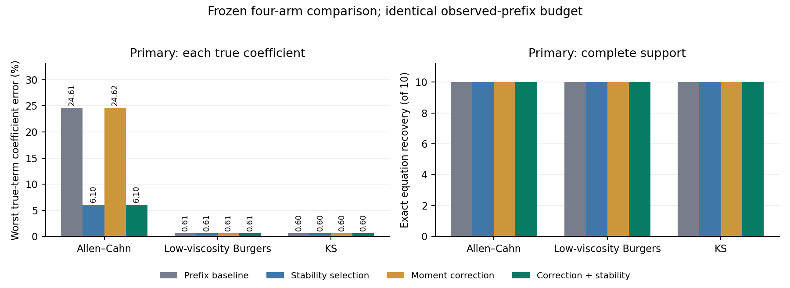
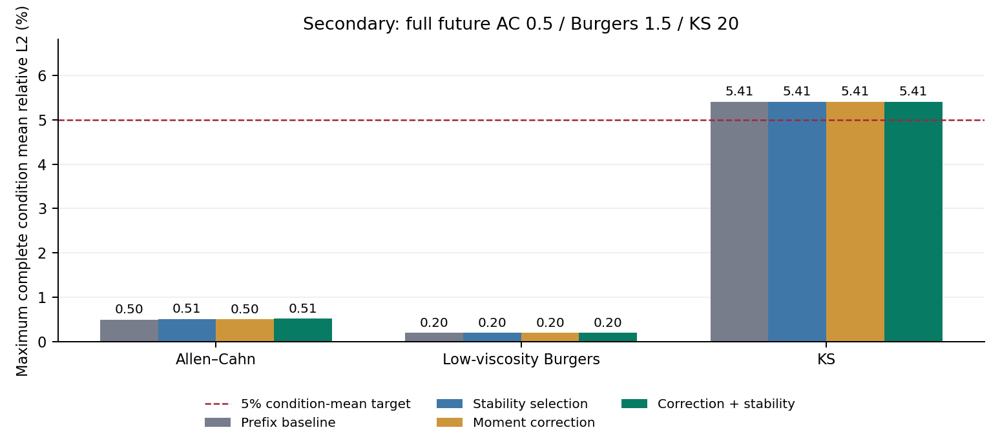

# PDE 系数可靠性对照实验

未通过冻结门槛，保留前缀基线，不合并。

冻结候选为 `noise_stable`，门槛通过 **125/126**；最终验证不根据四臂排名更换候选。回归测试须另行通过。

## 任务与隔离

四臂共享相同训练/开发/最终划分、观测噪声、11 帧（完整网格）或 6 帧（粗网格）历史观测，以及完整预测时长：Allen–Cahn 0.5、Burgers 1.5、KS 20。历史长度为预测时长的 10%，历史不计入预测评分，起始帧不计入误差。每条件有 3 条最终轨迹，三者完整均值才可判定 5% 目标。

共 3 类方程 × 2 种采样 × 5 种噪声条件 × 4 臂 = 120 条记录。数据是数值生成场；不是实测或新方程族的泛化证明。训练 3 条、开发 2 条、最终 3 条轨迹；全部 120 个模型冻结后才生成最终场。所有报告数字只读取保存的评分与模型 JSON。

## 主要指标：结构与系数

| 方法 | 完整恢复 | 多余项 | 缺失项 | 系数向量误差中位数 | 最坏真实项误差 |
|---|---:|---:|---:|---:|---:|
| 前缀基线 | 30/30 | 0 | 0 | 0.0213% | 24.6133% |
| 稳定性选择 | 30/30 | 0 | 0 | 0.0213% | 6.0971% |
| 噪声矩修正 | 30/30 | 0 | 0 | 0.0206% | 24.6206% |
| 矩修正＋稳定性 | 30/30 | 0 | 0 | 0.0263% | 6.1022% |

系数向量范数可能掩盖量级很小的扩散项，因此逐真实项误差为主要依据；逐条件、逐项的参考值、识别值、误差见 `coefficients.csv`。以下每格为该方程 10 个条件中该项的最大相对误差。

| 方程 / 真实项 | 前缀基线 | 稳定性选择 | 噪声矩修正 | 矩修正＋稳定性 |
|---|---:|---:|---:|---:|
| Allen–Cahn / `u` | 0.0704% | 0.0704% | 0.0578% | 0.0578% |
| Allen–Cahn / `u^3` | 0.1464% | 0.1464% | 0.1463% | 0.1463% |
| Allen–Cahn / `u_xx` | 24.6133% | 6.0971% | 24.6206% | 6.1022% |
| Low-viscosity Burgers / `u*u_x` | 0.1475% | 0.1475% | 0.1475% | 0.1475% |
| Low-viscosity Burgers / `u_xx` | 0.6071% | 0.6071% | 0.6071% | 0.6071% |
| KS / `u*u_x` | 0.1457% | 0.1457% | 0.1457% | 0.1457% |
| KS / `u_xx` | 0.5968% | 0.5968% | 0.5968% | 0.5968% |
| KS / `u_xxxx` | 0.5487% | 0.1756% | 0.5487% | 0.1756% |



## 辅助指标：完整时长预测

| 方法 | 最坏条件平均误差 | ≤5% 条件 | 完整均值条件 | 失败轨迹 |
|---|---:|---:|---:|---:|
| 前缀基线 | 5.4104% | 29/30 | 30/30 | 0/90 |
| 稳定性选择 | 5.4104% | 29/30 | 30/30 | 0/90 |
| 噪声矩修正 | 5.4104% | 29/30 | 30/30 | 0/90 |
| 矩修正＋稳定性 | 5.4104% | 29/30 | 30/30 | 0/90 |

出现失败时，表内最大值仅覆盖完整均值，不能据此声称全部达标；失败条件仍保留在 30 条分母中。5% 指每条件三条轨迹的平均误差，不要求每条轨迹、每个系数都低于 5%。



## 冻结门槛

126 项 = 1 项源质量 + 30 ×（结构完整、逐真实项精度、预测均值 ≤5%、系数向量不退化）+ 3 项方程族尾部不退化 + 2 项系数改善。无噪声/0.1% 噪声逐项上限 10%，1% 噪声上限 25%；系数不退化阈值为 max(1.25 × 基线, 1%)。改善要求 AC 最坏真实项相对降低至少 20%，且所有方程中的最坏真实项误差不增加。

AC 最坏真实项：24.6133% → 6.1022%，相对降低 75.2079%。全局最坏：24.6133% → 6.1022%。

失败项：

- `ks_unstable--coarse--noise1_s79--noise_stable:mean_prediction_at_most_5pct`

## 选择与噪声诊断

稳定性选择只在开发预测 RMSE 最优值的 1.05 倍近优池中比较最小支持，再以共同弱形式验证残差筛选 1.05 倍近优池，最后选择整条训练轨迹留一扰动最小的系数。该扰动是敏感性诊断，不是置信区间；诊断失败显式回退到原预测选择。

| 方法 | 改变选择 | 回退 | 失败的候选诊断 | 有训练噪声回执 |
|---|---:|---:|---:|---:|
| 前缀基线 | 0/30 | 0/30 | 0 | 0/30 |
| 稳定性选择 | 17/30 | 0/30 | 0 | 0/30 |
| 噪声矩修正 | 0/30 | 0/30 | 0 | 30/30 |
| 矩修正＋稳定性 | 17/30 | 0/30 | 0 | 30/30 |

冻结融合候选的观测噪声估计诊断如下，范围来自各训练轨迹，不是独立噪声重复实验。σ 使用各方程场的原始单位，跨方程不直接比较。

| 方程 | 无噪声条件估计 σ 范围 | 所有条件估计 σ 范围 |
|---|---:|---:|
| Allen–Cahn | 8.534e-06 — 0.002598 | 8.534e-06 — 0.008591 |
| Low-viscosity Burgers | 3.344e-06 — 0.02627 | 3.344e-06 — 0.02728 |
| KS | 0.001903 — 0.2561 | 0.001903 — 0.2596 |

噪声矩修正只从观测高频谱估计方差，按 2N Fourier 插值后的点方差修正 u²−v 与 u³−3vu；u·uₓ 同样使用修正平方。需要零均值、空间白高斯、轨迹内恒定方差及高频信号较弱的假设；真实高频物理成分会污染估计，干净场也可能得到正噪声估计。它不消除全部变量含噪回归偏差。`summary.json` 保存按训练轨迹去重的回执；不同弱形式、插值点和重叠窗口不作为独立样本。

## 已查看 AC 数据的回顾性诊断

以下为此前已查看的两种 AC 粗网格 1% 噪声条件，仅用于问题诊断，不计入上方最终验证、126 项门槛或 5% 达标结果；开发 RMSE 不是最终预测误差。

| 条件 | 方法 | 完整恢复 | 最坏真实项误差 | 开发 RMSE |
|---|---|---:|---:|---:|
| noise1_s103 | 前缀基线 | 是 | 4.5294% | 0.007172434 |
| noise1_s103 | 稳定性选择 | 是 | 1.6099% | 0.0072920405 |
| noise1_s103 | 噪声矩修正 | 是 | 4.5146% | 0.0071768338 |
| noise1_s103 | 矩修正＋稳定性 | 是 | 1.6176% | 0.0072980567 |
| noise1_s71 | 前缀基线 | 是 | 22.3396% | 0.0071252042 |
| noise1_s71 | 稳定性选择 | 是 | 8.3294% | 0.0073622273 |
| noise1_s71 | 噪声矩修正 | 是 | 22.3357% | 0.0071270297 |
| noise1_s71 | 矩修正＋稳定性 | 是 | 8.3345% | 0.0073632527 |

## 可追溯性与重现

渲染不读取场数组、不重新训练、重新选模或评分。`summary.json` 记录本报告输入、全局冻结、全部模型、科学代码、原始输入与最终参考场的 SHA-256；后两类数组哈希来自冻结/评分回执，渲染阶段不重新读取数组。CSV 使用 LF 换行。

```bash
python scripts/render_coefficient_study.py --output coefficient_study/results/first_run
```

该命令需要已有 `comparison.json` 与匹配的冻结模型。缺文件、哈希不匹配、改变历史预算、部分轨迹伪装完整均值或门槛矛盾会明确失败。新实验结果不可反过来调整本次协议后继续称为未见验证。

## 交付核验与决定

487项自动测试通过；独立审计重算结构、逐项系数和126项门槛，与原结果一致。12个最差条件模型的36次预测使用冻结系数重跑，直接用NumPy重算误差，与保存结果一致。源代码、输入、120模型和9最终轨迹的摘要核验通过。

决定：保留 `experiment/coefficient-reliability` 的全部记录，不合入默认版本。唯一效果门槛失败为KS粗采样、1%噪声、种子79的平均预测误差5.4104%；同一批新数据上四组都是5.4104%，不能归因于本次改动。此前4.0708%来自另一组最终初值，不是本批数据的基线。噪声矩修正未带来明确额外收益；稳定性选模是本轮系数收益的主要来源。原工作区1,360文件保持不变。

各组均有4/90条单轨迹误差超过5%，最大5.8236%，360次预测均成功。融合组的最坏逐项误差中位数从0.1845%升至0.2642%，因此主要结论是降低系数误差的最差尾部，不是所有条件或所有误差统计都改善。
