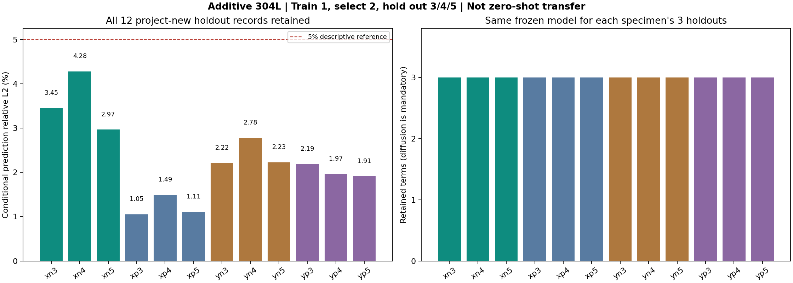

# 四根增材杆：十二条预定留出记录的首次评分

本项目此前未用于建模的 12 条预定留出记录已全部完成首次评分：四内点相对 L2 误差为 **1.0547%–4.2793%**，**12/12 低于描述性 5% 参考线**，且每条记录均优于初值持久值和同边界线性空间插值两种简单基线。

四根杆均由训练与开发数据选中 `D+h+c` 三项模型。这是原先固定的物理先验方法在新增记录上的条件预测证据，**不是 L1 自动发现、跨材料零样本迁移或唯一物性认证**。本次评分后，12 条记录已经被本项目查看，后续改方法不能继续将它们称为未见测试。

## 来源、重复关系与实际评价范围

数据来自 Tomanek 与 Stutts 发布的 [Mendeley Data，DOI 10.17632/sbcf36976g.1](https://data.mendeley.com/datasets/sbcf36976g/1)，许可 **CC BY 4.0**；配套数据论文 DOI [10.1016/j.dib.2021.107632](https://doi.org/10.1016/j.dib.2021.107632)，关联增材研究 DOI [10.1016/j.addma.2021.101886](https://doi.org/10.1016/j.addma.2021.101886)。作者说明及源码支持四根增材 304L 不锈钢杆各有五次测试记录。x/y 区分构建方向，p/n 区分作者的较多孔与非较多孔类别；n 不等于绝对零孔隙。

现有证据没有逐次确认风速、加热设定、环境漂移及装置重置完全一致。因此称“同杆重复测试记录”，不称严格同条件或统计独立的十二个装置实验。更详细的证据与获取限制见 [UNUSED_DATA_METADATA.md](UNUSED_DATA_METADATA.md)。本项目没有自行操作物理装置。

输入为用户提供的原始 ZIP。预处理只按白名单提取 20 个 CSV 原始字节并核对本地 CRC、SHA-256；准备阶段没有解析温度或打开作者 XLSX 结果表。包内声明的远端来源哈希一致性没有由本项目另行独立核验。留档见 [preparation_record.json](../pde_discovery/data/additive_heat/preparation_record.json)。

四组固定为 `xn,xp,yn,yp`：每组完整编号 1 训练、编号 2 开发选模、编号 3/4/5 留出。**四组模型全部冻结后，才解析任何一条留出温度。** 每根新杆都用自身编号 1 重新估计系数，未直接套用旧不锈钢、铝、铜组的参数，也未依据本轮旧数据可识别性诊断调整模型设置。

六个原始测点的间距为 0.007 m，时间单位 s，温度为相对环境温升 K。首末热电偶定义观察区间边界，不必位于整根杆端面。每次预测只接收两端全程实测温升及四内点首帧；之后四内点才用于评分。指标排除初始化首帧及已知边界，因此是**给定实测边界的四内点条件预测**，不是预测未知未来边界的自由演化。

## 全部十二条留出结果

| 记录 | 模型相对 L2（%） | 模型 RMSE（K） | 持久值 RMSE（K） | 同边界线性插值 RMSE（K） |
|---|---:|---:|---:|---:|
| xn3 | 3.4521 | 0.534914 | 15.513606 | 10.396764 |
| xn4 | 4.2793 | 0.708915 | 15.959371 | 10.331259 |
| xn5 | 2.9660 | 0.467799 | 16.144139 | 10.329687 |
| xp3 | 1.0547 | 0.190748 | 18.103936 | 13.744416 |
| xp4 | 1.4928 | 0.250527 | 17.621432 | 13.094255 |
| xp5 | 1.1084 | 0.193576 | 17.862927 | 13.484753 |
| yn3 | 2.2165 | 0.362889 | 16.925178 | 7.972101 |
| yn4 | 2.7778 | 0.492657 | 17.300000 | 8.061827 |
| yn5 | 2.2288 | 0.375311 | 16.292737 | 8.102968 |
| yp3 | 2.1912 | 0.331672 | 15.552149 | 8.187248 |
| yp4 | 1.9664 | 0.302414 | 15.624354 | 7.953276 |
| yp5 | 1.9117 | 0.289622 | 15.053879 | 7.976049 |

本次没有未评分或失败记录，没有根据误差排除组别。完整精度与逐内点指标见 [benchmark.json](../artifacts/additive_heat/benchmark.json) 及其中链接的十二份 `report.json`。5% 只是预先保留的描述性参考线，不是发现真实 PDE 的判定，也没有对应总体泛化置信水平。



## 每根杆的冻结候选与参数

沿用原来的四个候选、参数界限、三个起点、优化容差与传播器，模型族为：

\[
\theta_t=D\theta_{xx}-h\theta+c,\qquad D>0,\;h\ge0.
\]

编号 2 的开发 RMSE 在最优值 1.05 倍以内先选最少项，再选最低 RMSE。四组均只有 `D+h+c` 进入该近优集合；每组的一套冻结系数原样用于它的三条留出记录，没有按记录分别重拟合。

| 杆组 | D（m²/s） | h（s⁻¹） | c（K/s） | 训练 RMSE（K） | 开发 RMSE（K） |
|---|---:|---:|---:|---:|---:|
| xn | 2.08886467×10⁻⁶ | 0.0150036559 | +0.0422881945 | 0.460405 | 0.661975 |
| xp | 5.17755255×10⁻⁶ | 0.0302183489 | −0.1124085030 | 0.212863 | 0.272385 |
| yn | 5.14032371×10⁻⁶ | 0.0173902243 | −0.0636114103 | 0.372389 | 0.369912 |
| yp | 3.55426706×10⁻⁶ | 0.0150317584 | −0.0148233015 | 0.289542 | 0.303949 |

**h 是有效衰减率，不是单位为 W/(m²·K) 的对流换热系数。** c 可以补偿缺失机制、边界或测量偏差，不能直接解释成真实均匀体热源。这些都是六点粗网格的有效系数。

近优池中只有一种支持，表示当前四种预设结构在该开发记录上的选择结果较明确；不能排除候选族以外的方程。扩散项原本就是先验必选项，不能把它的出现称作自动发现。四组均保留 `unique_physical_equation_established=false`。

## 参数稳定性仍限制物性主张

四组全训练拟合的参数均未触界，局部缩放 Jacobian 条件数约为 **14.75–56.88**。但作为描述性诊断，分别重拟合训练前半与后半时，**四组后半 D 都到达设定下界 `1e-8 m²/s`**，yn 的 h 也到达下界；后半局部条件数约为 **662.95–2380.36**。

这不是置信区间，也不是独立重复实验的参数方差：两半采用不同的观测时间段、激励和温度区间，并分别从各段实测首帧重新初始化。激励不足、初值重置、模型失配及测量误差等因素都可能参与变化。本轮没有据此重新选模，无法单独确定变化原因。结果提示“预测能复现”与“参数稳定且可解释”为不同问题，不能仅凭十二条低误差记录把这些 D/h 数值包装成准确热物性。

对旧九组实施的更严格完整轨迹损失删块和 D 剖面另见 [IDENTIFIABILITY_REPORT.md](IDENTIFIABILITY_REPORT.md)；该诊断没有用于调整本轮新增材方法。跨温度共享 D 的联合拟合本轮未实施。

## 数据使用状态、核验与复现

按本项目及协作历史，这十二条记录在本次方法与角色冻结前未用于建模；这一限定不是全进程访问审计，也不保证所有外部参与者从未见过公开结果。评分已完成，**它们现在属于已查看数据**。若以后据此修改算法，后续分数应另记为方法调整后的比较，不能再把同一批数据宣传为新未见测试。

十二条记录只覆盖四根杆及相关装置条件，不能当作十二个独立装置样本估计总体推广能力。没有认证严格同工况、未知边界自由预测、跨设备泛化或唯一连续 PDE；没有接入华为平台。

四个模型哈希已逐一与 [冻结索引](../artifacts/additive_heat/freeze_index.json) 核对一致。索引 SHA-256：

`ac6aaba00d697ef5eaa00d7b68b3ff88e9ab3c0542af2a10b1da2b5159947c65`

协议见 [ADDITIVE_PROTOCOL.md](ADDITIVE_PROTOCOL.md)。在项目根目录用新目录复现，保留正式首次评分产物：

```bash
python -m pde_discovery additive-benchmark --phase freeze --output artifacts/additive_heat_reproduction
python -m pde_discovery additive-benchmark --phase evaluate --output artifacts/additive_heat_reproduction
```

也可一次执行固定完整流程：

```bash
python -m pde_discovery additive-benchmark --phase all --output artifacts/additive_heat_reproduction_all
python -m unittest discover -s tests -v
```

复现相同协议不会产生新的独立证据。本轮完整自动验收 **73/73 项通过**，记录还包括 82 份历史产物/方法哈希未变、四个模型及十二份报告引用的冻结哈希核对、15 项 HTTP 检查及浏览器检查。见 [验证摘要](../artifacts/expanded-validation-verification.json) 和 [测试日志](../artifacts/expanded-validation-unit-tests.log)。数值实现和隔离检查通过，不等于模型的物性解释得到认证。
