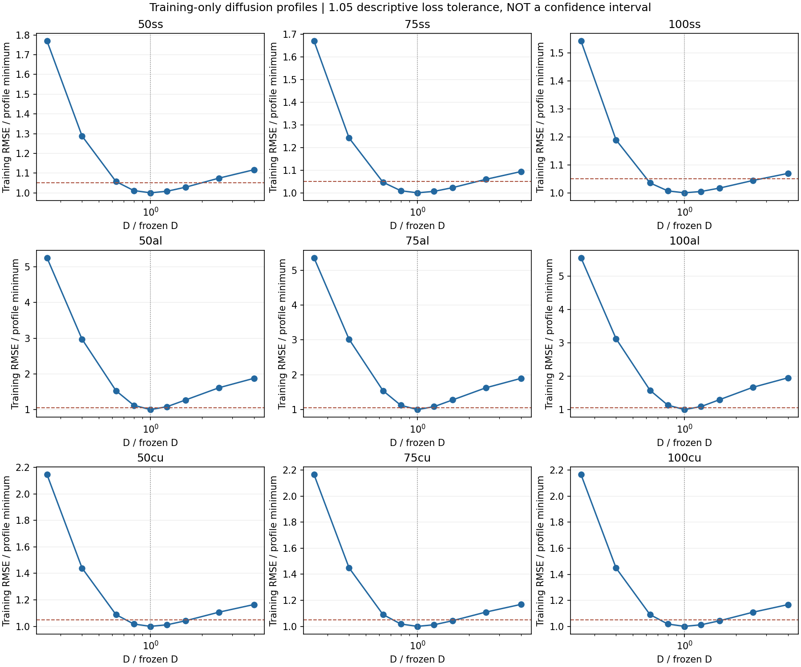

# 九组训练数据的参数可识别性诊断

九组固定诊断已完成：**81 个 D 剖面点和 45 次损失删块拟合全部完成**。结果说明，局部满秩和较低预测误差仍不足以保证参数稳定。100ss 在允许训练 RMSE 比剖面最优值高 5% 的已采样点中，D 的最大/最小值相差 **3.968 倍**；五次删块重拟合的 D 相差 **4.819 倍**。

这些是训练误差敏感性与数据影响诊断，**不是统计置信区间、不是新的验证分数，也没有替换原模型**。它们没有用于调节四根增材杆的模型族、界限或选模规则。新增十二条记录的结果另见 [ADDITIVE_REPORT.md](ADDITIVE_REPORT.md)。

## 分析对象和固定方法

数据仍来自 [Mendeley DOI 10.17632/sbcf36976g.1](https://data.mendeley.com/datasets/sbcf36976g/1)，CC BY 4.0。本诊断只读取旧九个温度组的**完整 repeat1 训练记录**以及既有 `artifacts/refined_heat` 冻结模型；没有读取开发记录、旧 repeat3 或新增材留出温度来完成诊断。来源与原角色见 [MENDELEY_PROTOCOL.md](MENDELEY_PROTOCOL.md)。

既有支持保持不变：不锈钢三组为 `D+h+c`，铝和铜六组为 `D+h`，对应物理先验族 `theta_t = D theta_xx - h theta + c`。D 的单位是 m²/s，h 是衰减率 s⁻¹而非 W/(m²·K) 的对流换热系数，c 的单位是 K/s。所有数值首先对应六点离散模型，不自动等于准确连续材料物性。

**D 剖面。** 用原冻结全训练 D₀ 乘以固定倍率 `0.25, 0.40, 0.63, 0.80, 1.00, 1.25, 1.60, 2.50, 4.00`。每个点固定 D，只重估原支持内存在的 h/c，使用原界限、起点、尺度和优化预算。定义离散近优点为训练 RMSE 不超过成功剖面最优值的 1.05 倍。这个“5% 容忍”是**训练 RMSE 相对变化**，与留出相对 L2 小于 5% 是不同量，更不意味着 95% 置信水平。

**五块损失删除。** 将完整训练时间跨度等分为五块，每次只从目标函数移除一块的未来四内点误差。传播仍经过完整时间轴、使用完整两端实测边界，并始终从原始首帧四内点初始化；不拼接时间段、不在删块后用实测内点重置。重估同一支持的全部自由参数，保存保留损失、完整训练误差及删块误差。五块来自同一条记录，不能当作五次独立实验。

所有配置先于对应训练加载序列化；模型先与旧冻结索引核对哈希。完整规则见 [IDENTIFIABILITY_PROTOCOL.md](IDENTIFIABILITY_PROTOCOL.md)，计算记录见 [protocol.json](../artifacts/identifiability/protocol.json)。本轮没有做跨温度共享 D 的联合拟合。

## 全部九组 D 结果

下表 D 的单位均为 m²/s，倍数是已获得数值的最大值除以最小值。剖面列只概括**有限采样点**的最小/最大值，不把两者之间未采样的 D 自动判为近优，更不代表连续置信区间。

| 组别 | 原冻结 D₀ | 近优剖面点最小–最大 D | 剖面最大/最小 | 五次删块最小–最大 D | 删块最大/最小 |
|---|---:|---|---:|---|---:|
| 50ss | 3.90321e-06 | 3.12257e-06–6.24514e-06 | 2.000 | 1.40041e-06–4.02158e-06 | 2.872 |
| 75ss | 4.57226e-06 | 2.88053e-06–7.31562e-06 | 2.540 | 4.5171e-06–6.2395e-06 | 1.381 |
| 100ss | 5.38955e-06 | 3.39542e-06–1.34739e-05 | 3.968 | 5.26765e-06–2.53848e-05 | 4.819 |
| 50al | 6.37097e-05 | 6.37097e-05（单个采样点） | 1.000 | 4.97492e-05–6.37815e-05 | 1.282 |
| 75al | 6.57441e-05 | 6.57441e-05（单个采样点） | 1.000 | 5.99787e-05–6.58107e-05 | 1.097 |
| 100al | 6.54324e-05 | 6.54324e-05（单个采样点） | 1.000 | 6.53495e-05–8.9668e-05 | 1.372 |
| 50cu | 9.38392e-05 | 7.50714e-05–0.000150143 | 2.000 | 9.36348e-05–0.000124619 | 1.331 |
| 75cu | 9.45349e-05 | 7.56279e-05–0.000151256 | 2.000 | 9.44173e-05–0.000109308 | 1.158 |
| 100cu | 9.68563e-05 | 7.74851e-05–0.00015497 | 2.000 | 9.65934e-05–0.000144346 | 1.494 |

九组参考点的局部 Jacobian 均满列秩，但以上数值显然并非全部紧密集中。本次近优点均未触及剖面网格最外端或 D 的原参数界限；这只描述本次有限搜索，不证明更远处不存在其他近优解。

完整点集与失败检查见 [summary.json](../artifacts/identifiability/summary.json) 及其九份报告。图中的连线仅用于显示已采样点的趋势，不增加未采样位置的证据。



## 100ss：训练误差接近，参数可相差数倍

原冻结 `D₀=5.38955226×10⁻⁶ m²/s`。在本次离散网格中，下列两个点都满足 1.05 倍训练 RMSE 规则：

| 固定 D | 拟合 h（s⁻¹） | 拟合 c（K/s） | 训练 RMSE（K） | 相对剖面最小 RMSE |
|---|---:|---:|---:|---:|
| 0.63 D₀ = 3.39541792×10⁻⁶ m²/s | 0.03952366 | −0.10375195 | 1.065826 | 1.03537 |
| 2.50 D₀ = 1.34738806×10⁻⁵ m²/s | 0.15155041 | −0.55030001 | 1.074677 | 1.04397 |

D 相差约 3.97 倍，h 与 c 同时补偿；仅查看训练轨迹误差很难把这些有效参数精确区分。该近优集合包括倍率 `0.63,0.8,1,1.25,1.6,2.5`，并不表示端点间每一个 D 都已经被计算。

损失删块给出另一类证据：删除最早约 `0–163.566 s` 的未来内点误差后，D 增至 `2.53847803×10⁻⁵ m²/s`，h 为 `0.28637454 s⁻¹`，c 到达预设下界 `−1 K/s`。模型依然从原始初值传播，不能把差异归因于在删块后重置初值。五次 D 的最小值为 `5.26764855×10⁻⁶ m²/s`，最大/最小为 4.819。

这提示参数对训练中早期信息敏感，也表明约束与参数补偿仍影响结果。c 的下界是我们预设的数值约束，不是确认了真实热源；4.819 倍也不是不确定性的绝对上限。激励、噪声和模型缺项的作用本轮不能单独分离。细节见 [100ss/report.json](../artifacts/identifiability/100ss/report.json)。

## 铝与铜的结果如何解读

三个铝组在这九个较稀疏 D 采样点中，仅原 D₀ 进入 1.05 倍训练误差集合。**单点集合不等于零宽度置信区间，也不证明 D 唯一。** 尚未采样的邻近 D 没有被分类；五次删块仍产生约 1.10–1.37 倍的 D 变化。

三个铜组的近优倍率均为 `0.8,1,1.25,1.6`，其最小/最大相差 2 倍；删块 D 分别相差约 1.33、1.16、1.49 倍。50ss 的近优 D 也相差 2 倍，删块相差约 2.87 倍。这些差异说明各组的信息量与参数敏感性不同，不能因为优化收敛或局部满秩就统一宣称“参数可靠”。

此次诊断固定已有支持，不把其他近优结构的不确定性包含进来。旧铝/铜六组在开发阶段仍存在 `D+h` 与 `D+h+c` 的结构歧义；对被选支持的条件诊断不会消除这项歧义。物理先验、边界测量误差和六点空间离散偏差同样未被转化为完整统计不确定性。

## 与此前分段诊断的区别及未做事项

此前前后半重拟合会分别从各段实测首帧初始化；本轮只删除损失，保留原始初值与全程传播，排除了这一种改变拟合问题的因素。两种方法回答的问题不同，不应把其范围混成一个置信区间。当前五块仍共享一次采集的装置、标定和噪声来源。

本轮没有根据这些曲线重新选支持或替换旧系数，没有将开发或留出数据并入拟合，没有通过扩展网格直到结果好看来收紧范围，也没有运行跨温度共享 D。正式置信区间、独立噪声标定、额外空间测量与连续材料物性认证仍未完成。

## 核验与复现

最终摘要记录 9/9 组诊断完成、81/81 个剖面点和 45/45 次删块拟合成功。对空删除块、观测不足、优化失败或不完整诊断有显式失败标记；本次实际九组没有触发这些失败。人工夹具验收覆盖不均匀时间及删除块观测扰动不影响该次拟合的隔离性质。

本轮完整自动验收 **73/73 项通过**。汇总核验还记录了 82 份历史产物/方法哈希保持不变，以及诊断源码哈希与结果匹配。见 [expanded-validation-verification.json](../artifacts/expanded-validation-verification.json) 和 [测试日志](../artifacts/expanded-validation-unit-tests.log)。实现检查通过不代表统计可识别性得到证明。

当前诊断摘要 SHA-256：

`ce81062a6f6ce8f39870c7cac63f3365ca9185a5ab74ae107d9772fbc3c59941`

在项目根目录用新目录复现，保留正式诊断产物：

```bash
python -m pde_discovery identifiability --output artifacts/identifiability_reproduction
python -m unittest discover -s tests -v
```

该命令读取旧九组训练记录与已有冻结支持，不更新旧模型，不进行新的留出评分，也不把诊断结果输入新增材选模。
