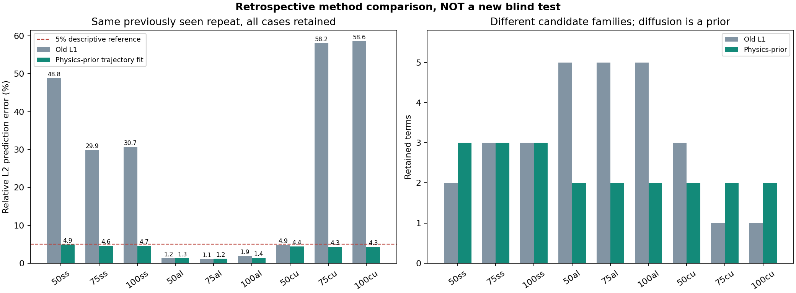

# 物理先验轨迹拟合：九组真实热杆数据的回顾性比较

固定九组比较已完成：新方法的四内点相对 L2 误差全部低于描述性 5% 参考线，范围 **1.236%–4.919%**；其中 **7/9 组优于旧 L1 方法**。50al、75al 的误差上升，三个铝组均从五项降为两项。新模型九组均优于初值持久值和同边界线性空间插值两种简单基线。

这支持“在当前数据上的条件预测有所改善”，**不支持已发现唯一真实 PDE 或准确材料物性**。扩散项是事先规定的物理先验，新方法不是 L1 自动发现；第三次重复在上一轮已经查看，因此本轮是回顾性方法比较，不是新的独立盲验。六个组仍保留结构歧义，训练前后半的参数差异也很大。

## 数据与固定方法

来源为 Tomanek 与 Stutts 发布的 [Mendeley Data，DOI 10.17632/sbcf36976g.1](https://data.mendeley.com/datasets/sbcf36976g/1)，配套数据论文 DOI [10.1016/j.dib.2021.107632](https://doi.org/10.1016/j.dib.2021.107632)，许可 CC BY 4.0。输入为用户提供的原始压缩包，已检查本地 ZIP CRC、压缩包与逐文件 SHA-256；包内声明的远端哈希一致性没有由本项目另行独立核验。本项目没有操作实验装置。

九组为不锈钢、铝、铜各三个温度档位；各组完整文件 1 拟合、文件 2 选模、文件 3 回顾评分。温度前缀是试验档位，不是风速。传感器间距分别为 0.007、0.010、0.015 m。每组只使用六个原始测点；首末热电偶是观察区间边界，不必位于整根杆的物理端面。

固定模型族为：

\[
\theta_t=D\theta_{xx}-h\theta+c,\quad D>0,\;h\geq0.
\]

只比较 `D`、`D+h`、`D+c`、`D+h+c` 四种预设支持。训练直接最小化四内点轨迹误差，不把含噪内点的二阶空间差分作为回归特征；空间算子仍是原网格中央差分。传播器使用四状态线性系统的正弦模态及分段线性实测边界输入。参数界限、三个优化起点、收敛容差和预算均在冻结配置中记录。

选模只用文件 2 的 RMSE：最优值 1.05 倍以内优先最少项，再取最低误差。九组模型及代码、协议哈希全部冻结后才进入本轮文件 3 评分；没有根据新比较分数修改参数或更换候选。参数和支持仍仅由训练及开发阶段确定，原 L1 报告保留。

所有预测只接收两端的完整实测温升序列与四内点首帧。评分排除初始帧及边界点，计算其后四内点 RMSE 和相对 L2；所以这是**已知实测边界下的条件预测**，不是预测未知未来边界的自由演化。完整协议见 [REFINEMENT_PROTOCOL.md](REFINEMENT_PROTOCOL.md)。

## 全部九组结果

表中误差来自同一个已见过的第三次重复、相同评价点和时间范围；项数并不代表两种方法具有相同的先验。

| 组别 | 旧 L1 相对 L2（%） | 新方法相对 L2（%） | 旧 RMSE（K） | 新 RMSE（K） | 项数：旧 → 新 | 误差变化 |
|---|---:|---:|---:|---:|---:|---|
| 50ss | 48.816 | 4.919 | 3.113328 | 0.313743 | 2 → 3 | 下降 |
| 75ss | 29.852 | 4.633 | 4.587354 | 0.711994 | 3 → 3 | 下降 |
| 100ss | 30.724 | 4.660 | 6.627947 | 1.005238 | 3 → 3 | 下降 |
| 50al | 1.247 | 1.259 | 0.202507 | 0.204606 | 5 → 2 | 上升 |
| 75al | 1.056 | 1.236 | 0.311382 | 0.364378 | 5 → 2 | 上升 |
| 100al | 1.905 | 1.415 | 0.752489 | 0.558759 | 5 → 2 | 下降 |
| 50cu | 4.860 | 4.445 | 0.680347 | 0.622172 | 3 → 2 | 下降 |
| 75cu | 58.151 | 4.337 | 14.246932 | 1.062441 | 1 → 2 | 下降 |
| 100cu | 58.567 | 4.285 | 21.153349 | 1.547602 | 1 → 2 | 下降 |

不锈钢三组选中 `D+h+c`，铝与铜各三组选中 `D+h`。50al 的误差增加约 **0.0129 个百分点、0.00210 K**，75al 增加约 **0.1798 个百分点、0.05300 K**；更少的项在这两组付出了预测误差代价，不能表述为九组均改善。各组都低于 5% 仅描述本轮数值结果，不构成新的泛化保证。



机器可读总表见 [benchmark.json](../artifacts/refined_heat/benchmark.json)。逐组目录中的 `report.json` 还保留逐传感器误差、两种简单基线、优化状态及限制；没有删除失败工况，本次九组均完成计算。

## 预定主要案例 50ss

50ss 的全训练拟合候选为：

\[
\theta_t=(3.903212\times10^{-6})\theta_{xx}
-0.0483283241\theta-0.0546764144.
\]

其中温升 `θ` 用 K、位置用 m、时间用 s；`D=3.903212×10⁻⁶ m²/s`，`h=0.0483283241 s⁻¹`，`c=−0.0546764144 K/s`。这里 **h 是有效衰减率，不是单位为 W/(m²·K) 的对流换热系数**。负常数项可能承担偏差或缺失机制的有效补偿，不能据此认定杆内存在真实的恒定负热源。

该模型训练 RMSE 为 0.296128 K、开发 RMSE 为 0.307793 K、回顾比较 RMSE 为 0.313743 K，最后一个数对应相对 L2 **4.919377%**。回顾比较中四个内点 TC2–TC5 的 RMSE 分别约为 0.326430、0.430671、0.205737、0.243677 K。

这是六点离散模型的有效系数；下面的参数稳定性诊断限制了对这些数字的物性解释。完整精度及轨迹见 [50ss/report.json](../artifacts/refined_heat/50ss/report.json) 与 [50ss/validation.png](../artifacts/refined_heat/50ss/validation.png)。

## 六组结构歧义没有消失

50al、75al、100al、50cu、75cu、100cu 的开发误差近优池都包含 **`D+h` 与 `D+h+c`**。固定复杂度规则选择两项模型，但这不证明常数项在物理上恰为零；六组报告继续标为 `ambiguous`。

不锈钢三组在这四种预设支持中只有 `D+h+c` 进入近优池。这个结果只反映当前候选族和数据，不能排除族外方程或确认扩散必选这一先验已经被独立证明。九组的 `unique_physical_equation_established` 均为 `false`。

## 参数稳定性：误差低仍不足以认证物性

九个全训练拟合的局部 Jacobian 均满列秩、选中参数均未触及设定边界。三个固定起点的最终参数已完整记录；选中支持内，起点间非零系数的最大相对跨度约为 **5.54×10⁻⁶**，说明这三个起点得到了很接近的解。但有限起点的一致性不证明全局最优，也不说明参数对数据变化稳定。

局部条件数基于优化坐标 `log(D), h/0.01, c/0.1`，依赖这一尺度选择，不能当作物性的标准误差或置信区间。下表同时列出训练前后半分别重拟合的结果；`h` 为正衰减率，表中接近零的极小数已写为“约 0”。

| 组别 | 全训练局部条件数 | 前半 D（m²/s） | 后半 D（m²/s） | 前半 h（s⁻¹） | 后半 h（s⁻¹） |
|---|---:|---:|---:|---:|---:|
| 50ss | 95.85 | 4.283×10⁻⁶ | 1.000×10⁻⁸ | 0.053759 | 0.0000864 |
| 75ss | 116.50 | 4.378×10⁻⁶ | 1.000×10⁻⁸ | 0.052572 | 0.0000785 |
| 100ss | 154.48 | 4.950×10⁻⁶ | 1.000×10⁻⁸ | 0.057142 | 0.0000784 |
| 50al | 56.33 | 6.394×10⁻⁵ | 6.045×10⁻⁸ | 0.067967 | 约 0 |
| 75al | 54.36 | 6.591×10⁻⁵ | 6.816×10⁻⁸ | 0.066733 | 约 0 |
| 100al | 54.94 | 6.532×10⁻⁵ | 6.594×10⁻⁸ | 0.067341 | 约 0 |
| 50cu | 41.87 | 9.361×10⁻⁵ | 4.855×10⁻⁸ | 0.054149 | 约 0 |
| 75cu | 42.85 | 9.451×10⁻⁵ | 5.360×10⁻⁸ | 0.055296 | 约 0 |
| 100cu | 44.55 | 9.617×10⁻⁵ | 1.000×10⁻⁸ | 0.055718 | 约 0 |

所有九组后半重拟合都至少有一个参数触及下界：不锈钢三组的 D 到达 `1e-8 m²/s`，铝、铜六组的 h 近零，100cu 的 D 同时到达下界。后半局部条件数约为 **285.02–1494.21**，高于全训练的 **41.87–154.48**。50ss 的常数项也从前半 `−0.0626013 K/s` 变为后半 `+0.000239361 K/s`。因此不能只凭全训练拟合收敛和较低预测误差宣称参数已稳定恢复。

这项检查不是统计置信区间：前后半属于同一次训练采集，有不同的激励信息、温度区间和噪声实现，并分别从各段首帧重新初始化。后段可能缺少足够的瞬态信息，重置初值也改变拟合问题；模型失配、边界误差等同样可能参与参数变化。本轮不能区分这些原因，也没有据此重新选模。全部 18 次分段拟合均报告优化成功，**数值收敛与物理可辨识性并不是同一件事**。

更细的参数剖面、独立传感器噪声标定及统计置信区间本轮没有完成。未使用的风速和增材数据本轮也未纳入，不能承诺已经获得新的独立盲验。方法审查和后续验证边界见 [REFINEMENT_REVIEW.md](REFINEMENT_REVIEW.md)。

## 验证记录与复现

现有自动验收记录为 **55 项全部通过**，日志见 [refinement-unit-tests.log](../artifacts/refinement-unit-tests.log)。验收包括数值传播、输入完整性、训练/开发/比较隔离及失败路径；测试通过不等于物性获得认证。

已复核九个冻结模型与索引中的哈希一致。冻结索引 SHA-256 为：

`1fe2d022166c6cdc0a39dedf1df8e3f445b241657c11f39b85129e2f8062f3c6`

另与改进前记录逐一核对了旧目录的 **38 个产物哈希，均未变化**。冻结记录见 [freeze_index.json](../artifacts/refined_heat/freeze_index.json)，旧产物清单见 [refinement-original-artifact-hashes.json](../artifacts/refinement-original-artifact-hashes.json)。

在项目根目录运行，建议使用新的输出目录以保留本次归档：

```bash
python -m pde_discovery refined-benchmark --phase freeze --output artifacts/refined_heat_reproduction
python -m pde_discovery refined-benchmark --phase evaluate --output artifacts/refined_heat_reproduction
```

第一条只拟合、选模和冻结；第二条核验全部声明工况的冻结模型、代码与协议后才进行回顾评分。也可执行等价的完整流程：

```bash
python -m pde_discovery refined-benchmark --phase all --output artifacts/refined_heat_reproduction_all
python -m unittest discover -s tests -v
```

本轮未操作硬件、未验证跨装置泛化、未接入华为平台。下一步若要主张物理参数或新数据泛化，仍需要事先冻结的新验证安排及此前未用于方法决策的合适实验记录。
