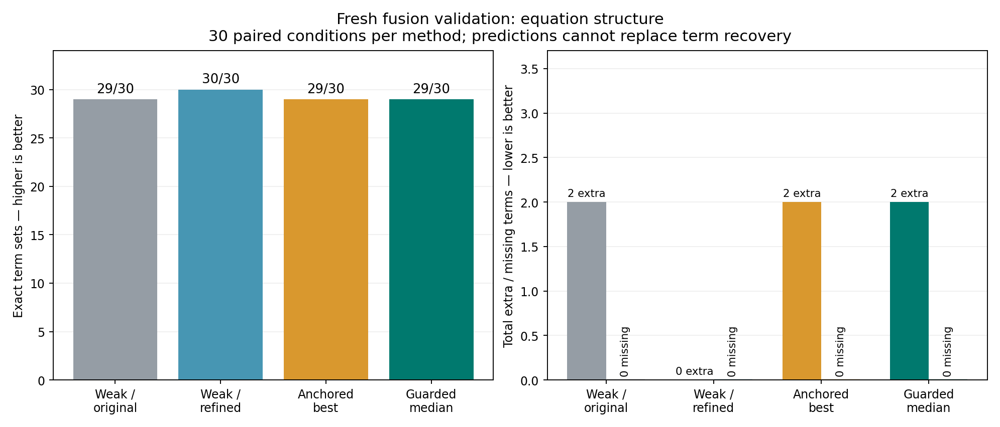
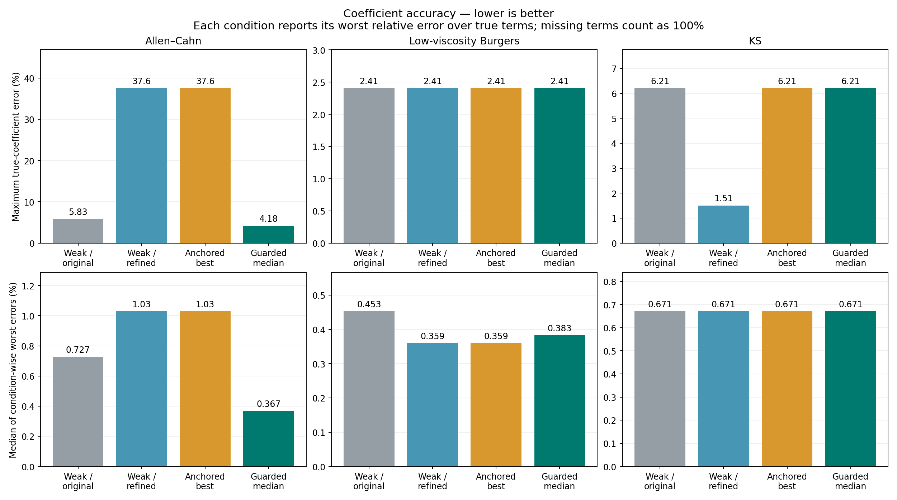
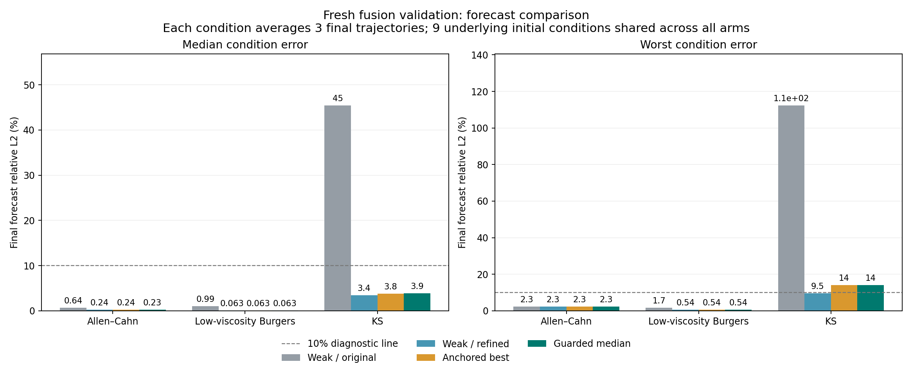

# PDE 结构锚定与系数融合：改善局部精度，但不整体合入

融合值得作为候选继续研究，但本次“固定旧结构 + 同结构系数中位数 + 四倍网格预测”**未达到整体替换标准**。新初值验证中，Allen–Cahn 家族最坏真实项系数误差相对加密弱形式从 **37.58% 降到 4.18%**；与此同时，一个无噪声 KS 条件继承了旧结构中的两个多余项。完整项恢复从加密版的 **30/30 降为 29/30**，最坏条件平均预测误差从 **9.52% 升为 13.97%**。预设门槛通过 **171/178**，**不合并，保留基线和独立实验记录**。

本轮分支为 `experiment/fused-weak-pde`。方法与协议在任何新训练/开发场生成前冻结于 `807c53357dab868da4621082f7b777f3bd4aae6a`。没有根据新最终成绩修改规则、阈值、系数或项集。下述新验证和旧数据回顾性分析分别报告。

## 融合了什么

沿用固定的 compact、low、resolved 三种时空弱形式测试函数、adaptive L1 候选路径和归一化 OLS 去偏。九项库为 `1,u,u²,u³,u_x,u_xx,u_xxx,u_xxxx,u*u_x`，无必选项。多轨迹共同拟合，每条训练轨迹等权。没有跨 λ 惩罚目标排名或路径出现频次投票。

1. 原弱形式用原观测网格上的开发预测选择结构锚；锚不存在就保留失败。
2. 在**完全相同项集合**的训练候选中，用四倍内部网格计算开发预测误差。每个弱变体至多贡献一次，重复时按稳定训练候选 ID 去重。
3. 保留误差不超过同结构最佳值 `1.05×best+1e−12` 的变体，按项名对物理系数取等权中位数。只有一个近优变体时保持同结构最佳候选。
4. 用加密预测器重新检查中位数向量的开发误差；超出同一阈值、出现零/非有限系数或求解失败时回退同结构最佳候选，不删项、不换结构。
5. 冻结最后选中的项及系数后，以四倍内部网格推进最终轨迹。

结构选择和系数选择使用不同预测器，这是明确的两阶段算法，不能声称所有阶段使用同一预测器。开发数据用于多个选择步骤，因此开发误差仅是选模依据。三种变体共享训练观测，中位数并不来自三个独立实验，也不是置信区间。

| 方法 | 结构与系数选择 | 最终预测 |
|---|---|---|
| weak_original（WO） | 原弱形式，原网格开发选择 | 原网格 |
| weak_resolved（WR） | 相同训练候选，加密网格开发选择 | 四倍网格 |
| anchored_best（AB） | 固定 WO 项集，取加密开发误差最小的同结构候选 | 四倍网格 |
| fused_median（FM） | 固定 WO 项集，执行上述中位数及开发检查 | 四倍网格 |

四臂共享一次训练候选生成和两套开发评分，避免重复拟合造成差异。AB 是消融对照，用来区分结构锚定与系数中位数的作用；它不替代两个预定基线。

## 已查看旧数据：回顾性结果

旧 resolved 数据上的 60 条 WO/WR 记录直接复用；60 个 AB/FM 决策仅用旧开发观测生成，全部冻结后才读取旧最终场进行 180 次新推进。所有数据已经查看，因此不是新的留出验证。详见 [回顾性独立复核](RETROSPECTIVE_REVIEW.md) 和 [完整记录](development/retrospective/comparison.json)。

| 旧数据方法 | 完整恢复 | 多余项 | 最坏真实项系数误差 | 预测误差中位数 | 最坏条件平均预测误差 |
|---|---:|---:|---:|---:|---:|
| WO | 30/30 | 0 | 37.2935% | 1.62562% | 98.85294% |
| WR | 29/30 | 1 | 37.2935% | 0.36316% | 8.53596% |
| AB | 30/30 | 0 | 37.2935% | 0.36316% | 8.53596% |
| FM | 30/30 | 0 | 15.7373% | 0.37187% | 8.53596% |

旧数据支持局部融合动机：结构锚消除了多余项，中位数额外改善了扩散系数。21 个条件接受中位数，9 个只有单一近优变体；实际 15 个系数向量改变，其中 11 个预测误差上升。没有只呈现受益条件。

该回顾性运行没有独立记录启动瞬间的源码摘要；运行后核对的引擎摘要与冻结记录一致，开发者确认运行中未改引擎。此限制保存在 [来源收据](development/retrospective/provenance.json)。后续复现脚本已增加启动与结束的源码一致性检查，没有为此重跑或重新选模。本轮正式新验证使用严格准备/模型摘要冻结，不依赖该回顾性收据作晋级判断。

## 新验证的隔离与范围

仍为 Allen–Cahn `u_t=0.0001u_xx+5u−5u³`、Burgers `u_t=0.03u_xx−u*u_x`、KS `u_t=−u_xx−u_xxxx−u*u_x` 三个已知数值方程族；物理参数、网格和初值分布与上一轮相同。新角色种子为 108000/108100/108200/108300，分别用于校准/训练/开发/最终。每族 3 条训练、2 条开发、3 条最终轨迹。

采样为 full/coarse；噪声为 0、0.1%、1%，非零种子 61/97。先对完整角色场加噪，再按时空 `[::2]` 得到粗采样；噪声标准差只由完整干净训练场的等轨迹 RMS 决定，只有污染函数接收它。方法入口只有 `x,t,u,boundary`，不接收家族、真实系数、真实噪声尺度或未来观测。

全部 120 个模型先冻结，摘要核验后才首次生成 9 条最终轨迹。360 次计划推进全部完成，无失败或遗漏；但共享 **9 个底层最终初值**，不能视为 360 个独立实验。预测由带噪首帧初始化，干净未来只评分，初帧排除在误差外，同时保存带噪未来指标。

独立校准以空间加倍、时间步减半为对照，固定限值为相对 L2 ≤1e−5、最大绝对差 ≤1e−4。三族两次校准逐字段一致；相对 L2 / 最大绝对差分别为 AC `6.85304e−12 / 1.01723e−11`、Burgers `5.24200e−9 / 4.19720e−8`、KS `2.62148e−7 / 2.44228e−6`。这只认证校准初值的数值一致性，不逐条认证所有正式轨迹。

## 新初值的全部四臂对照

所有误差列均为百分数。项恢复严格比较集合，未事后删掉小系数；缺项按真实项误差 100% 计。本轮全部方法漏项为 0。系数向量相对 L2 依赖各项尺度，不能替代逐项相对误差。预测每条件先对 3 条最终轨迹取相对 L2 均值，再跨条件统计。

| 方法，各30条件 | 完整恢复 | 多余项 | 系数向量误差中位数 | 最坏真实项误差 | 预测误差中位数 | 最坏条件预测 | 预测>10%的条件 |
|---|---:|---:|---:|---:|---:|---:|---:|
| WO | 29/30 | 2 | 0.05206% | 6.21485% | 1.55152% | 112.32690% | 5/30 |
| WR | 30/30 | 0 | 0.03993% | 37.58195% | 0.40416% | 9.52295% | 0/30 |
| AB | 29/30 | 2 | 0.03993% | 37.58195% | 0.40416% | 13.97457% | 1/30 |
| FM | 29/30 | 2 | 0.03993% | 6.21485% | 0.42427% | 13.97457% | 1/30 |

| 方程族 | 完整恢复 WO / WR / AB / FM（各10） | 最坏真实项误差 WO / WR / AB / FM |
|---|---|---|
| Allen–Cahn | 10 / 10 / 10 / 10 | 5.83328% / 37.58195% / 37.58195% / 4.17899% |
| Burgers | 10 / 10 / 10 / 10 | 2.40826% / 2.40826% / 2.40826% / 2.40826% |
| KS | 9 / 10 / 9 / 9 | 6.21485% / 1.50790% / 6.21485% / 6.21485% |

FM 23 个条件接受中位数，7 个只有单一近优变体；实际 16 个系数向量与 AB 不同，其中 12 个条件预测误差上升、4 个下降。中位数在 AC 的尾部系数精度上有额外收益，Burgers/KS 的最坏逐项误差没有额外下降。FM 全部真实项误差均低于 10%，但这不代表没有多余项。

WR 的最坏**单轨迹**预测误差为 12.12277%，FM 为 17.70813%；“所有条件均值低于10%”不能解读为每条轨迹低于10%。10%仅为诊断线，未用它替换预设相对回归门槛。

## 为什么仍然不合入

协议事先要求对 WO、WR 两个对照同时保持：逐条件系数向量误差 ≤`max(1.25×对照,1%)`、预测误差 ≤`max(1.25×对照,5%)`；无干净结构退化；总完整恢复不下降、多余/漏项及预测失败不增加。每个真实项误差在干净/0.1%噪声时 ≤10%，1%噪声时 ≤25%；每族最坏真实项误差 ≤`max(1.25×各对照,1%)`。

针对剩余弱系数问题，明确收益预先定义为：至少一个家族的最坏真实项误差，相对 **两个对照同时** 降低至少25%且至少5个百分点。这是固定工程门槛，不是显著性检验，也不允许用预测改善替代。全部178项中171项通过，7项失败：

| 未通过检查 | 证据 |
|---|---|
| KS coarse clean 对 WR 的系数向量回归 | 3.65027% > 1.25×0.92182%=1.15228% |
| 同条件预测回归 | 13.97457% > max(1.25×3.28683%,5%)=5% |
| 同条件干净结构不得退化 | 继承 WO 的多余 `u³` 和 `u_x`，WR 无多余项 |
| 相对 WR 总完整恢复不得下降 | 29/30 < 30/30 |
| 相对 WR 总多余项不得增加 | 2 > 0 |
| KS 家族最坏逐项误差保护 | 6.21485% > 1.25×1.50790%=1.88488% |
| 明确收益须同时超过两个对照 | AC 相对 WR 降33.40296个百分点；相对 WO 仅降1.65429个百分点，未到5个百分点 |

前六项都与同一个 KS 结构锚问题有关。其多余项系数分别为 `−9.944702025e−5 u³` 和 `−0.0009990073029 u_x`；同结构候选只有一个，无法靠中位数修复。四阶真项系数为 `−1.0621484547`，偏差6.21485%。不能因为这些多余系数数值小而事后删除。

AC 的最大系数误差下降是**家族最大值的比较**，最大值所在条件不同：WR/AB 的最坏为 coarse、1%、种子61，FM 最坏为 full、1%、种子97。不能将37.58%→4.18%误写为同一条件的逐点变化。

本轮证据支持把“同结构系数中位数”保留为研究候选，同时拒绝无条件固定旧结构。后续可以研究两路结构分歧的处理，但那是需要新协议、新留出数据的下一项实验，不能看过当前真值后改选 KS 的结构并称作本轮成功。

## 检查、记录与使用

[冻结独立审阅](FREEZE_REVIEW.md) 核对120个模型、17个源码/协议摘要、16个输入摘要，60/60个融合支持集保持原锚，23个中位数向量的62个系数重算一致。[结果独立审阅](RESULT_REVIEW.md) 及 [CSV](results/first_run/summary.csv)、[完整JSON](results/first_run/comparison.json) 保留全部120条结果与360个预测记录。代码在方法冻结前通过 [317项聚合检查](../artifacts/fusion-frozen-code-tests.log)，包括实际串行/并行结果一致性、数据隔离和失败保留。

新工作树首次聚合检查因未携带旧外部实验的忽略目录来源清单而出现15个缺文件错误；从上一交付包恢复缺少的原始夹具、未覆盖已有文件后全部通过。初次失败与恢复日志分别保存在 `artifacts/fusion-before-freeze-tests.log` 和 `artifacts/fusion-before-freeze-tests-restored.log`，没有改弱化测试来通过。

运行命令和自有数据 API 见 [FUSION_README](../FUSION_README.md)。原界面与生产基线保持原样，融合方法仅位于独立命令行/Python入口。代码和回退历史交付到原私有页，旧附件保留。

本轮没有新真实测量，也没有二维、多变量、非周期边界或任意PDE泛化证据；范围仍是一维均匀周期、自治常系数标量九项库。计算网格插值点不是观测。当前新数据已评分，今后再用于改方法必须标为回顾性或复现。没有完成华为平台集成的声明。
