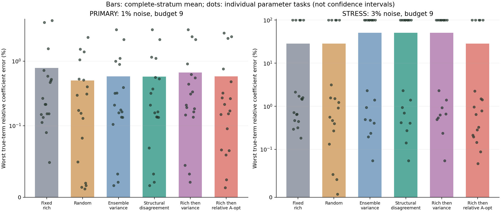
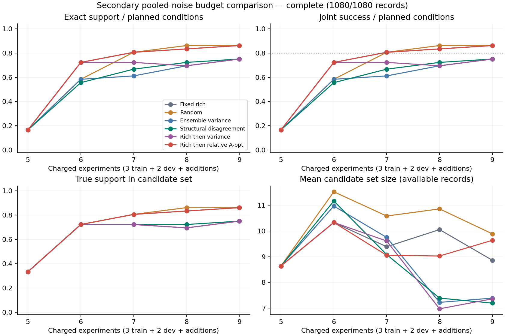

# PDE 参数相对实验设计：已完成实验的只读报告

结果状态：**complete**；保存 1080/1080 条预算记录。
条件 36/36；参数任务 18。六策略共享识别器、初始训练/开发数据、预算和候选初值池。

验证标签：first frozen same-family synthetic validation
审计状态：**passed**；来源 `audit.json`，与当前结果的绑定状态 `verified`。未完成、未绑定或过期的审计不表示通过。

保存判定：`retain_baseline_do_not_merge`；assessment.json 状态 `verified`。本报告只读取判定，不自行运行晋级规则；不自动合并。

主指标固定为：预算 9、1% 噪声下，逐个参数任务先取所有真项的最大系数相对误差，再对计划的 18 个任务取均值。3% 噪声为单列压力测试，不混入主指标。条件不完整或系数误差不可计算时，均值/中位数/最坏值均保留 null，不通过删除失败改善指标。
rich_then_variance 与 rich_then_information 的第一次追加实验都固定为丰富激励；其后分别采用集成方差与参数相对 A-opt 代理。两者的差异用于检验后续选择方法的贡献。A-opt 代理不是 Fisher 信息或信息增益的保证。
晋级结论另见 DECISION.json；本报告仅汇总保存指标，不选择胜者、不修改模型。预测使用 11 帧历史前缀，保留完整 1.0 时长预测。
预算包括 3 次初始训练＋2 次开发＋追加实验；追加失败仍收费。每次实验 111×64＝7104 个标量，最终验证成本单列。
1% = sigma 0.004; 3% = sigma 0.012, both relative to fixed initial-field RMS 0.4, not each trajectory RMS.

主指标：预算 9、1% 噪声

|策略|真项最坏系数误差：均值|中位数|跨任务最坏|有效系数条件|结构完整|联合成功|预测失败轨迹|
|---|---:|---:|---:|---:|---:|---:|---:|
|固定丰富激励|0.786%|0.240%|4.272%|18/18|18/18|18/18|0|
|随机实验|0.501%|0.235%|2.342%|18/18|18/18|18/18|0|
|集成预测方差|0.580%|0.192%|3.093%|18/18|18/18|18/18|0|
|结构分歧|0.577%|0.187%|3.093%|18/18|18/18|18/18|0|
|先丰富激励＋集成方差|0.664%|0.259%|3.093%|18/18|18/18|18/18|0|
|先丰富激励＋相对 A-opt|0.583%|0.192%|2.726%|18/18|18/18|18/18|0|

压力测试：预算 9、3% 噪声（单列，不替代主指标）

|策略|真项最坏系数误差：均值|中位数|跨任务最坏|有效系数条件|结构完整|联合成功|预测失败轨迹|
|---|---:|---:|---:|---:|---:|---:|---:|
|固定丰富激励|28.452%|1.473%|100.000%|18/18|13/18|13/18|15|
|随机实验|28.350%|1.072%|100.000%|18/18|13/18|13/18|15|
|集成预测方差|50.362%|51.156%|100.000%|18/18|9/18|9/18|27|
|结构分歧|50.370%|51.156%|100.000%|18/18|9/18|9/18|27|
|先丰富激励＋集成方差|50.404%|51.156%|100.000%|18/18|9/18|9/18|27|
|先丰富激励＋相对 A-opt|28.272%|0.869%|100.000%|18/18|13/18|13/18|15|

逐任务明细：`coefficient_by_task.csv` 保留预算 9、两档噪声、全部六策略的各任务误差；`comparison.csv` 保留全部预算。

下表为次指标，合并 1% 与 3% 两档噪声的预算对照。联合成功仍固定为：结构完全恢复＋每个真项系数相对误差 ≤10%＋3 条最终轨迹平均相对 L2 ≤5%。≥80% 联合成功目标保持不变。

|策略|预算|完全恢复|联合成功|候选集覆盖|平均集合大小|最差真项误差（条件均值 / 最坏）|遗漏 / 多余项总数|最坏预测均值|完整预测条件 / 失败轨迹|
|---|---:|---:|---:|---:|---:|---:|---:|---:|---:|
|固定丰富激励|5|6/36|6/36|12/36|8.64|90.08% / 328.73%|39 / 7|不可界定|15/36 / 63|
|固定丰富激励|6|26/36|26/36|26/36|10.33|28.56% / 100.00%|13 / 0|不可界定|26/36 / 30|
|固定丰富激励|7|29/36|29/36|29/36|9.39|20.18% / 100.00%|10 / 0|不可界定|29/36 / 21|
|固定丰富激励|8|30/36|30/36|30/36|10.06|17.39% / 100.00%|9 / 0|不可界定|30/36 / 18|
|固定丰富激励|9|31/36|31/36|31/36|8.86|14.62% / 100.00%|8 / 0|不可界定|31/36 / 15|
|随机实验|5|6/36|6/36|12/36|8.64|90.08% / 328.73%|39 / 7|不可界定|15/36 / 63|
|随机实验|6|21/36|21/36|26/36|11.53|39.26% / 100.00%|17 / 7|不可界定|27/36 / 27|
|随机实验|7|29/36|29/36|29/36|10.58|19.93% / 100.00%|10 / 0|不可界定|29/36 / 21|
|随机实验|8|31/36|31/36|31/36|10.86|14.38% / 100.00%|8 / 0|不可界定|31/36 / 15|
|随机实验|9|31/36|31/36|31/36|9.89|14.43% / 100.00%|8 / 0|不可界定|31/36 / 15|
|集成预测方差|5|6/36|6/36|12/36|8.64|90.08% / 328.73%|39 / 7|不可界定|15/36 / 63|
|集成预测方差|6|21/36|21/36|26/36|10.97|39.43% / 100.00%|17 / 8|不可界定|26/36 / 30|
|集成预测方差|7|22/36|22/36|26/36|9.75|36.58% / 100.00%|16 / 5|不可界定|26/36 / 30|
|集成预测方差|8|25/36|25/36|25/36|7.22|31.09% / 100.00%|15 / 0|不可界定|25/36 / 33|
|集成预测方差|9|27/36|27/36|27/36|7.39|25.47% / 100.00%|12 / 0|不可界定|27/36 / 27|
|结构分歧|5|6/36|6/36|12/36|8.64|90.08% / 328.73%|39 / 7|不可界定|15/36 / 63|
|结构分歧|6|20/36|20/36|26/36|11.17|45.01% / 100.00%|19 / 10|不可界定|26/36 / 30|
|结构分歧|7|24/36|24/36|26/36|9.08|31.07% / 100.00%|14 / 3|不可界定|26/36 / 30|
|结构分歧|8|26/36|26/36|26/36|7.39|28.31% / 100.00%|13 / 0|不可界定|26/36 / 30|
|结构分歧|9|27/36|27/36|27/36|7.19|25.47% / 100.00%|12 / 0|不可界定|27/36 / 27|
|先丰富激励＋集成方差|5|6/36|6/36|12/36|8.64|90.08% / 328.73%|39 / 7|不可界定|15/36 / 63|
|先丰富激励＋集成方差|6|26/36|26/36|26/36|10.33|28.56% / 100.00%|13 / 0|不可界定|26/36 / 30|
|先丰富激励＋集成方差|7|26/36|26/36|26/36|9.61|28.41% / 100.00%|13 / 0|不可界定|26/36 / 30|
|先丰富激励＋集成方差|8|25/36|25/36|25/36|6.97|31.12% / 100.00%|15 / 0|不可界定|25/36 / 33|
|先丰富激励＋集成方差|9|27/36|27/36|27/36|7.36|25.53% / 100.00%|12 / 0|不可界定|27/36 / 27|
|先丰富激励＋相对 A-opt|5|6/36|6/36|12/36|8.64|90.08% / 328.73%|39 / 7|不可界定|15/36 / 63|
|先丰富激励＋相对 A-opt|6|26/36|26/36|26/36|10.33|28.56% / 100.00%|13 / 0|不可界定|26/36 / 30|
|先丰富激励＋相对 A-opt|7|29/36|29/36|29/36|9.06|20.08% / 100.00%|10 / 0|不可界定|29/36 / 21|
|先丰富激励＋相对 A-opt|8|30/36|30/36|30/36|9.03|17.22% / 100.00%|9 / 0|不可界定|30/36 / 18|
|先丰富激励＋相对 A-opt|9|31/36|31/36|31/36|9.64|14.43% / 100.00%|8 / 0|不可界定|31/36 / 15|

未完成、失败和缺失结果保留在计划条件分母中；平均集合大小仅针对已有记录。只要有最终轨迹预测失败或条件缺失，全体最坏预测均值就标为“不可界定”；成功条件中的最坏有限均值另存 summary.json，不能当作全体上界。缺失预算点不表示已实际花费该计划预算。错误单集合指候选集中仅有一个结构且该结构错误，不表示系统声称物理唯一性。

同质量成本：以 ≥80% 条件达到联合成功为目标，在完整结果中读取首次达到目标的预算；这不是使用真值的在线停止规则。
- 固定丰富激励：7 次实验。
- 随机实验：7 次实验。
- 集成预测方差：未获得可比较的达标预算（null）。
- 结构分歧：未获得可比较的达标预算（null）。
- 先丰富激励＋集成方差：未获得可比较的达标预算（null）。
- 先丰富激励＋相对 A-opt：7 次实验。
- 先丰富激励＋相对 A-opt 相对固定丰富激励的总预算节省：0.0%。
- 先丰富激励＋相对 A-opt 相对随机实验的总预算节省：0.0%。
- 先丰富激励＋相对 A-opt 相对集成预测方差的总预算节省：不可估计（null）。
- 先丰富激励＋相对 A-opt 相对结构分歧的总预算节省：不可估计（null）。
- 先丰富激励＋相对 A-opt 相对先丰富激励＋集成方差的总预算节省：不可估计（null）。

最大预算下的不确定性描述：

|策略|错误单集合 / 全部条件|单集合总数|正项 Brier|负项 Brier|平衡 Brier|可计算条件|
|---|---:|---:|---:|---:|---:|---:|
|固定丰富激励|0/36|0|0.0000|0.0000|0.0000|25/36|
|随机实验|0/36|0|0.0038|0.0020|0.0029|27/36|
|集成预测方差|0/36|1|0.0022|0.0010|0.0016|21/36|
|结构分歧|0/36|0|0.0010|0.0007|0.0008|23/36|
|先丰富激励＋集成方差|0/36|1|0.0033|0.0017|0.0025|24/36|
|先丰富激励＋相对 A-opt|0/36|0|0.0018|0.0002|0.0010|26/36|

最大预算 9 次的联合成功对照：固定丰富激励 31/36；随机实验 31/36；集成预测方差 27/36；结构分歧 27/36；先丰富激励＋集成方差 27/36；先丰富激励＋相对 A-opt 31/36。
固定丰富激励是强对照；上述数据无论哪种策略更好都完整保留。此处仅作配对条件的描述性比较，没有宣称统计显著优势。

自助法项包含频率仅表示稳定性，不是真项概率。正/负项平衡 Brier 为描述性误差；不宣称概率已校准。结构集覆盖必须同时结合集合大小阅读。
同一参数任务的两档噪声是配对条件，36 个条件不能视为 36 个独立物理系统；这里没有给出独立同分布意义的置信区间。

审计回执摘要（完整回执保存在 audit.json，或尚待生成）：
```json
{
  "effective_status": "passed",
  "source": "audit.json",
  "binding_status": "verified",
  "reported_status": "passed",
  "checks": 1383,
  "failed_checks": [],
  "runtime_chronology_independently_authenticated": false,
  "comparison_sha256": "db06ec93566f191f91e7c04540a5b2521fd83c5848acfaa5de266e5151a30c5b"
}
```

范围：受控合成周期 PDE、固定传感器和边界、等成本初值选择；没有新增真实测量验证，也没有解决旧 KS 实验的 5% 失败。已有数据再分析必须标为回顾性。
本页不运行识别、选模或预测，只汇总 comparison.json。闭环动作的逐步回放见 `python -m information_study.app --port 8768`。

comparison.json SHA-256：`db06ec93566f191f91e7c04540a5b2521fd83c5848acfaa5de266e5151a30c5b`

产物：`coefficient_by_task.csv`（主指标与压力逐任务数据）、`primary_coefficients.png`（两档噪声分列系数图）、`comparison.csv`（全部逐条件指标）、`summary.json`（所有分母与缺失计数）、`budget_curves.png`（次指标预算曲线）。

[逐条件 CSV](results/first_run/comparison.csv) · [汇总 JSON](results/first_run/summary.json) · [逐任务系数 CSV](results/first_run/coefficient_by_task.csv) · [审计回执](results/first_run/audit.json) · [保存判定](results/first_run/assessment.json)




