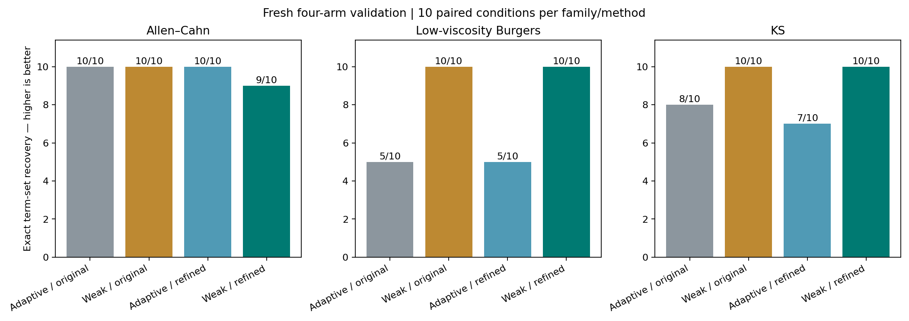
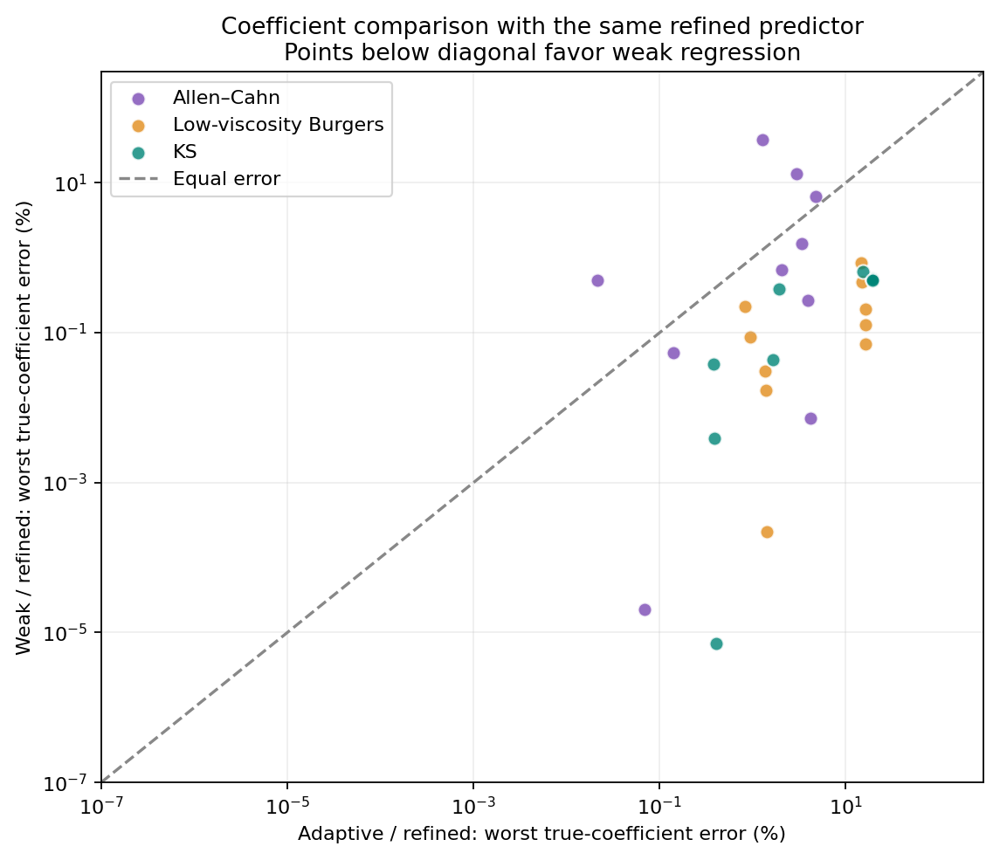
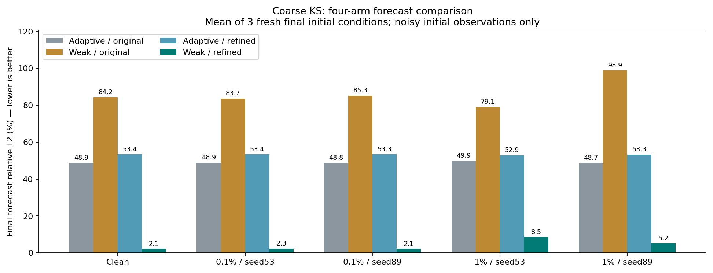

# 固定内部网格加密：弱形式 PDE 识别的四臂验证

固定 4 倍内部网格使弱形式的粗采样 KS 预测明显改善，但本轮仍**不合入，保留基线**。候选 weak_resolved 在新初值上完整恢复 **29/30**，相同预测器的 adaptive_resolved 为 **22/30**；候选全部 30 个条件的平均预测误差低于 10%。不过一个 Allen–Cahn 扩散系数误差达 **37.2935%**，且比 weak_original 少一次完整恢复、多一个项。预设门槛仅通过 **169/172**，预测收益不能覆盖主要识别指标的失败。

方法与协议在新训练/开发数据生成前冻结于 `ea0fb061e93fd018546cbfa3501917441df82af1`。本轮只增加独立实验实现，旧生产代码、L1、challenge 与 weak 实验保持原样。没有根据最终结果调参、删项或修改门槛。

**改进范围与对照设计**

上一轮弱形式改善了方程恢复，却在粗采样 KS 的最终预测中退化。本轮把预测器的内部空间网格固定加密 4 倍，开发选模与最终预测同时使用该规则。给定的带噪观测初帧经周期 Fourier 插值到计算网格，原时间积分器推进后，直接取回原观测点。插值点是计算自由度，不是新增测量，也不能恢复初帧本来没有的真实高频信息。

| 方法 | 识别候选 | 开发选模和最终预测的内部网格 |
|---|---|---|
| adaptive_original | 原时间积分特征 + adaptive L1 | 原观测网格 |
| weak_original | 上轮时空弱形式 + adaptive L1 | 原观测网格 |
| adaptive_resolved | 与 adaptive_original 相同的候选生成规则 | 4 倍观测网格 |
| weak_resolved | 与 weak_original 相同的候选生成规则 | 4 倍观测网格 |

九项库仍为 `1,u,u²,u³,u_x,u_xx,u_xxx,u_xxxx,u*u_x`，L1 路径和归一化 OLS 去偏不变。弱形式仍用时间窗 0.25、空间模态占比 1/8、1/32、1/4 的三个固定变体，统一模态规则 `min(Nx//4,max(8,floor(Nx×占比)))`，没有按方程家族调参。具体积分分部、求积和乘积处理沿用 [弱形式方法报告](../weak_study/REPORT.md)。

每臂按其自身预测器计算开发轨迹等权 RMSE，在最优值的 1.05 倍加 1e−12 内优先最少项，再比较误差与固定编号。因此预测器改变可以改变被选中的方程，不能把本实验解释成只在最终评分时替换网格。没有跨方法事后回退、跨 λ 惩罚目标排名或路径频次选模；拟合与选模不接收真方程、真实噪声方差或最终未来场。

4 倍规则在新数据前固定，对所有家族一致。周期插值处理偶数网格 Nyquist 拆分，推进仍用原积分器和每输出区间 32 个子步。内部网格最多 2048 点，默认规则最多接受 512 个观测空间点；超预算明确拒绝，不静默降低分辨率。

**旧 KS 的 72 次控制诊断：回顾性证据**

[诊断记录](development/DIAGNOSIS.md) 使用上一轮已经查看的粗采样 KS：无噪声和 1% 噪声种子 71，各 3 条旧最终轨迹。没有重新拟合旧系数，也未生成本轮正式初值。54 次空间控制，加 6 次时间加密控制，共 [60 条记录](development/resolution_diagnosis.json)；另保留 [12 次初帧投影控制](development/initial_projection_diagnosis.json)。下表是排除初帧后的轨迹相对 L2 均值，单位为 %。

| 旧条件与系数来源 | 原网格 | 2 倍内部网格 | 4 倍内部网格 |
|---|---:|---:|---:|
| 无噪声，真实方程诊断对照 | 116.1500 | 0.235879 | 0.000000894 |
| 无噪声，冻结 adaptive 系数 | 48.4995 | 41.9905 | 41.9913 |
| 无噪声，冻结 weak 系数 | 97.9751 | 9.92826 | 9.93170 |
| 1% 噪声，真实方程诊断对照 | 115.0987 | 6.27795 | 6.27523 |
| 1% 噪声，冻结 adaptive 系数 | 48.7785 | 42.3718 | 42.3725 |
| 1% 噪声，冻结 weak 系数 | 87.9687 | 18.5232 | 18.5228 |

仅将时间子步加倍，干净真实方程在原网格的误差仍为 116.1500%；4 倍空间网格则约为 0.000000494%。先按旧 64 点网格的 2/3 截断投影初帧，再以 4 倍网格推进，干净初帧相对变化仅 4.73e−16，真实方程与冻结 weak 的误差仍约为 0.000000894% 和 9.93170%。1% 噪声投影后对应误差为 6.26542% 和 18.51615%，与未预投影的加密结果接近。

这些控制支持：在选定的旧干净轨迹中，粗网格上的推进是主要误差来源之一。偏差较大的 adaptive 系数在粗网格反而胜过真方程，加密后次序逆转，与系数偏差部分补偿离散误差的解释一致。该诊断不证明其他家族的普遍机制，也未认证混沌。加密后的冻结 weak 仍明显差于真实方程对照，说明加密不能消除系数误差。真系数只用于标明的诊断对照，生产预测接口不接收真方程或未来场。

**新初值、来源与冻结隔离**

本轮三个数值方程仍为 Allen–Cahn `u_t=0.0001u_xx+5u−5u³`、Burgers `u_t=0.03u_xx−u*u_x`、KS `u_t=−u_xx−u_xxxx−u*u_x`。物理参数、初值分布、网格和时域与上一轮 weak 验证相同，使用新的角色种子 88000/88100/88200/88300；它们是已知家族的新初值，不是真实测量或新的未知 PDE 家族。

每族 3 条训练、2 条开发、3 条最终轨迹；3 族 × 2 采样 × 5 噪声条件 × 4 方法共 **120 个配置**。方法与 [协议](protocol.json) 先冻结，再准备训练/开发数据；120 个模型及依赖摘要全部冻结后才生成 9 条最终轨迹。源质量由独立校准初值在空间加倍、时间步减半时比较，相对 L2 ≤ 1e−5、最大绝对差 ≤ 1e−4，失败不得替换成容易样本。

噪声标准差为完整干净训练轨迹等权 RMS 的 0、0.1%、1%，非零种子为 53/89。同条件四臂共享观测，先在完整角色网格加噪，再在角色内按时空 `[::2]` 得到粗采样；不同采样和噪声强度间存在配对关系。只有污染环节接触干净场及噪声尺度。开发和最终均从带噪首帧出发，最终干净未来只评分，同时记录带噪未来指标，初帧不纳入误差。

360 次计划预测共享 **9 条底层最终轨迹**，不能当成 360 次独立物理实验。独立校准只检查该校准初值的数值一致性，不逐条认证正式轨迹。适用范围仍为一维均匀周期、自治常系数、标量九项库；没有真实测量、非周期或二维多变量泛化证据。

**事先固定的指标和晋级门槛**

主要指标为项集合是否完整恢复、多余/漏项数、系数向量相对 L2，以及每个真实项的相对系数误差；缺项计 100% 误差，不事后删掉微小多余系数。系数向量相对 L2 依赖各项的坐标与场尺度，不具单位不变性；逐项相对误差另行报告。预测是辅助指标，每条件先对 3 条最终轨迹取相对 L2 均值，再按条件汇总。

候选 **weak_resolved** 同时与 **adaptive_resolved** 和 **weak_original** 比较：要求没有干净条件结构退化，完整恢复总数不下降，多余项、漏项和推进失败总数不增加；每配置系数向量误差 ≤ `max(1.25×对照,1%)`、预测误差 ≤ `max(1.25×对照,5%)`。候选每个真实项误差在无噪声和 0.1% 噪声时 ≤ 10%，在 1% 噪声时 ≤ 25%，并要求全部配置、源质量和回归检查通过。

明确收益相对 adaptive_resolved，预先允许两个路径之一：新增完整恢复至少 2 条且覆盖至少 2 族；或至少 2 族的“每条件最坏真实项误差”的中位数相对下降至少 25% 且绝对下降至少 1 个百分点。该 OR 规则在新数据前写定；只通过收益路径不能豁免其他检查。另报告绝对预测误差超过 10% 的数量、最坏值与分族结果；10% 是诊断线，不是新增门槛。相对门槛通过不能表述成每个预测都低于 10%，这些工程门槛也不是统计显著性检验。

**冻结后 120 个配置的完整对照**

120 个模型全部选出并记录；360/360 次最终推进完成、失败为 0，这只说明求解返回有限结果。全部方法漏项为 0。表中系数和预测均为百分数，多余项为 30 条件的累计项数；完整恢复严格比较项集合，中位数按条件等权。

| 方法（各 30 条件） | 完整恢复 | 多余项 | 系数向量误差中位数 | 预测误差中位数 | 最坏条件预测误差 | 条件预测 >10% |
|---|---:|---:|---:|---:|---:|---:|
| adaptive_original | 23/30 | 9 | 0.32877% | 1.64040% | 49.90148% | 5/30 |
| weak_original | 30/30 | 0 | 0.02613% | 1.62562% | 98.85294% | 5/30 |
| adaptive_resolved | 22/30 | 13 | 0.32877% | 1.43333% | 53.44027% | 5/30 |
| weak_resolved | 29/30 | 1 | 0.02592% | 0.36316% | 8.53596% | 0/30 |

以下简写 **AO / WO / AR / WR** 依次对应上表四臂，每族各 10 个条件。“逐项中位数”先取每条件最坏真实项误差，再跨该族条件取中位数，是预声明收益规则的量。

| 方程族 | 完整恢复 AO / WO / AR / WR | 逐项中位数 AR → WR（%） | 最坏条件预测 AO / WO / AR / WR（%） |
|---|---|---|---|
| Allen–Cahn | 10 / 10 / 10 / 9 | 2.49223 → 0.59128 | 2.13221 / 2.09430 / 2.22873 / 2.14183 |
| Burgers | 5 / 10 / 5 / 10 | 7.98127 → 0.10748 | 2.50773 / 2.70946 / 1.53153 / 0.53700 |
| KS | 8 / 10 / 7 / 10 | 8.53483 → 0.43997 | 49.90148 / 98.85294 / 53.44027 / 8.53596 |

前三臂各 5 个超过 10% 的条件全部来自 KS，候选三族均为 0/10。候选最大系数向量误差为 **0.38069%**，但向量误差小并不保证每个弱系数准确。四臂分别进行开发选模，因此本轮结果能比较完整流程，不能把所有差异只归于固定系数下的网格改变；后者由前述旧数据控制单独研究。

| 采样 / 噪声 | AO 完整恢复 | WO 完整恢复 | AR 完整恢复 | WR 完整恢复 |
|---|---:|---:|---:|---:|
| full / 无噪声 | 3/3 | 3/3 | 3/3 | 3/3 |
| full / 0.1% | 6/6 | 6/6 | 6/6 | 6/6 |
| full / 1% | 4/6 | 6/6 | 4/6 | 5/6 |
| coarse / 无噪声 | 2/3 | 3/3 | 2/3 | 3/3 |
| coarse / 0.1% | 4/6 | 6/6 | 4/6 | 6/6 |
| coarse / 1% | 4/6 | 6/6 | 3/6 | 6/6 |




**预测退化得到改善，但识别门槛仍失败**

新初值上的 5 个粗采样 KS 条件，WR 相比两个预定对照均明显降低预测误差。下表仍为各条件 3 条最终轨迹的干净未来相对 L2 均值，单位 %；它与旧诊断表的初值不同，不能跨两表当作逐轨迹配对比较。

| coarse KS 条件 | AO | WO | AR | WR |
|---|---:|---:|---:|---:|
| 无噪声 | 48.87437 | 84.20824 | 53.36236 | 2.14304 |
| 0.1%，种子 53 | 48.94900 | 83.67444 | 53.44027 | 2.27619 |
| 0.1%，种子 89 | 48.84730 | 85.26507 | 53.34826 | 2.13596 |
| 1%，种子 53 | 49.90148 | 79.07924 | 52.85828 | 8.53596 |
| 1%，种子 89 | 48.73455 | 98.85294 | 53.30493 | 5.19707 |



两个收益路径均通过：相对 AR 新增 8 个完整恢复条件，覆盖 Burgers 和 KS，同时丢失 1 个 AC 条件，净增 7；三族的逐项中位数改善也均达到预声明阈值。相对两个对照的逐条件向量误差及预测回归检查全部通过。然而以下 **3 条门槛失败**，其他 169 条通过：

| 失败检查 | 具体证据 |
|---|---|
| AC coarse、1% 噪声、种子 89 的逐真实项精度 | 扩散系数 `1.3729348249e−4`，真值 `1e−4`，误差 **37.29348% > 25%** |
| 相对 WO 完整恢复总数不得下降 | **29/30 < 30/30** |
| 相对 WO 多余项总数不得增加 | **1 > 0** |

后两条来自 **AC full、1% 噪声、种子 89** 的同一个结构失败：WR 多选了 `u_xxxx`，系数为 `−3.91827647e−9`。按既定严格项集口径保留为多余项，不能看过真值后以系数小为由删除。它与 coarse 条件的扩散系数失败是两条不同配置。

coarse 的扩散系数失败条件仍完整恢复所有项，其整体向量误差仅 **0.03564%**、预测误差仅 **2.14183%**；较大的反应项掩盖了小扩散系数的相对误差。候选无噪声、0.1%、1% 三档的最坏真实项误差分别为 **0.51750%、1.55593%、37.29348%**。所以改善预测、完整找齐项和准确恢复每个系数仍需分别检验，不能把 29/30 解释成 29 个方程的系数全部达标。

**记录、回归与最终处置**

全部 120 条配置见 [CSV](results/first_run/summary.csv) 和 [完整 JSON](results/first_run/comparison.json)，未省略失败配置；JSON 保留逐项系数及每条最终轨迹的预测指标。三族独立校准均通过，相对 L2 / 最大绝对差分别为 AC `6.8471e−12 / 1.0107e−11`、Burgers `3.2910e−9 / 2.7196e−8`、KS `3.0902e−7 / 3.3180e−6`。这些数值来源于校准记录，不是识别误差。

[最终回归日志](../artifacts/resolved-final-tests.log)：**267 项通过，18.211 秒**。包含既有流程与新预测器的解析解、Cole–Hopf 对照、奇偶 Nyquist、factor1 等价、输入不可变性、物理约束、预算拒绝及冻结隔离检查；开发期子集测试不重复累加。报告核对 [冻结清单](results/first_run/freeze_index.json) 的 120 个唯一模型文件及所列源文件哈希，全部一致。编写报告只读取派生 JSON、模型与日志，没有读取原始场数组、重训或重评分。

在安装依赖、校准凭据匹配的干净副本中按 [运行说明](README.md) 复现；已有准备数据不重复 prepare，输出目录需尚不存在：

```bash
python -m unittest discover -s tests -v
python -m resolved_study.run prepare
python -m resolved_study.run freeze --workers 3 --output resolved_study/results/reproduction
python -m resolved_study.run evaluate --output resolved_study/results/reproduction
```

结果 JSON 的 SHA-256 为 `dea65390377628b33f8f467e445d0c1cca68a2f5836ef7378c10162c1d4d9689`；冻结清单为 `c09ee2485969aff745e47f84a8fbc8ad26e342267d7061df87e9ef7e37ef746f`。已有准备、模型与部分最终场拒绝覆盖，完整失败记录保留。

按预先约定，**不合并本轮实验分支，继续保留原基线**。空间加密对这一数值分布中的 KS 预测有效，但尚未全面满足方程识别目标。后续若处理弱扩散系数或小多余项，必须重新制定开发与最终验证隔离，不能回头修改本轮结论；本轮已查看数据今后的比较应标为回顾性或复现。没有真实测量、任意 PDE 泛化或华为平台集成完成的声明。
