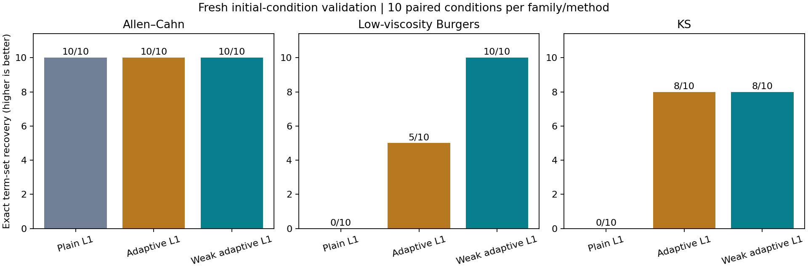
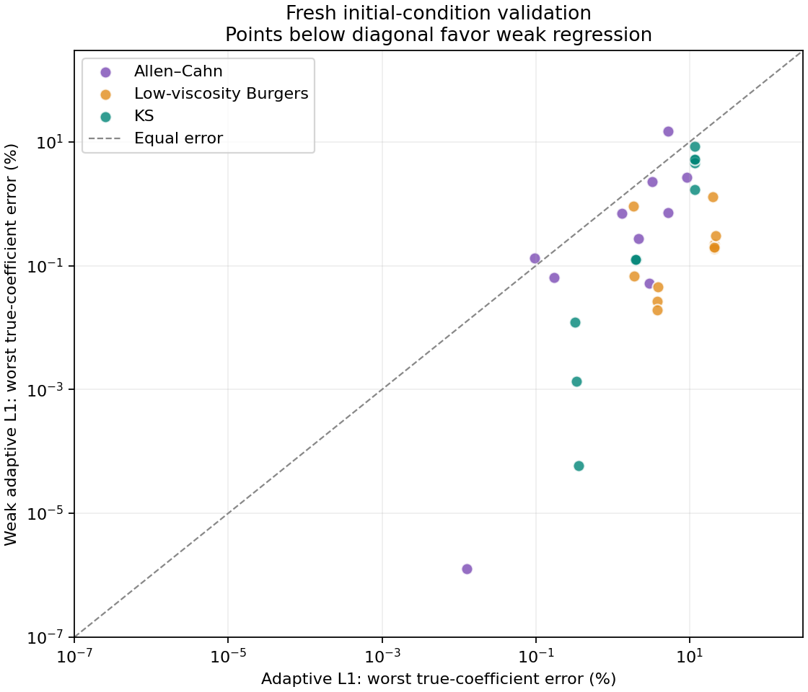
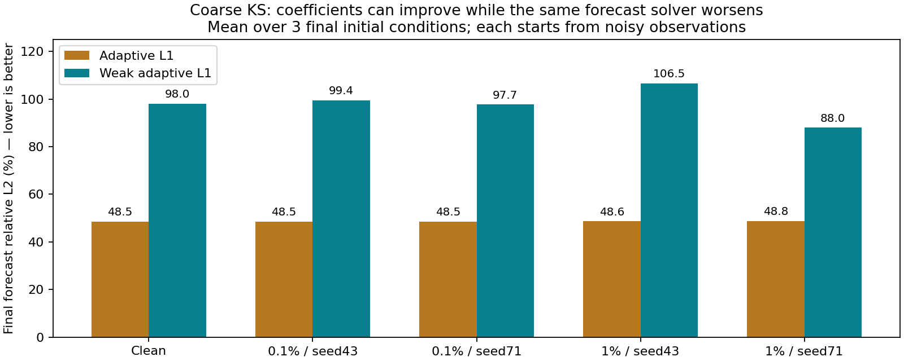

# 时空弱形式 PDE 识别：回顾性改进与冻结后的新初值验证

弱形式改善了方程结构和系数恢复，但本轮**不合入，保留基线**。在冻结后生成的新初值上，完整项恢复由 adaptive 的 **23/30** 提高到 weak_adaptive 的 **28/30**，多余项由 **10** 降至 **4**，漏项均为 **0**；然而粗采样 KS 的 5 个条件全部触发预测回归门槛。预设检查通过 **97/102**，不能凭结构收益覆盖这些失败，也没有在看到最终结果后修改参数或门槛。

方法与协议冻结提交：`540a0624fc171d36ddc7f31fcc1e3cc733ee207d`。本报告依据已保存的模型、派生指标和日志整理；编写时未读取原始场数组、重新拟合或重新评分。生产实现、上一轮 L1 与 challenge 实验代码保持原样。

**方法改动与适用范围**

目标仍是从时空观测恢复 PDE 的项与系数。适用范围限定为一维、均匀网格、周期边界、自治、常系数、标量方程；共用候选库为 `1,u,u²,u³,u_x,u_xx,u_xxx,u_xxxx,u*u_x`。评分参考如下，参考系数不参与拟合与开发集选模。

| 方程族 | 评分参考方程 | 挑战 |
|---|---|---|
| Allen–Cahn | `u_t = 0.0001u_xx + 5u − 5u³` | 扩散系数远小于反应系数，整体误差容易掩盖它 |
| 低黏度 Burgers | `u_t = 0.03u_xx − u*u_x` | 陡峭梯度、粗采样与噪声 |
| KS | `u_t = −u_xx − u_xxxx − u*u_x` | 不稳定模式、四阶导数与长时预测；未认证混沌性 |

新增 weak_adaptive 将时空导数转移到已知测试函数，使用包含零频的空间 Fourier 测试和时间紧支撑多项式 `φ(z)=(1−z²)^4`。时间积分分部得到 `∫u_tφ=−∫uφ_t`；输运项按 `u*u_x=½∂x(u²)` 处理。非零 Fourier 实虚部按 √2 加权，保留零频以识别常数及反应项。

非线性乘积用 2N 零填充与相应 Nyquist 处理，时间采用原采样点上的复合闭 Newton–Cotes 求积，每面板 8 个子区间、代数精度 9。该做法避免直接求观测导数，但仍有有限求积误差、噪声和变量误差偏差；插值点不视作新增测量。没有噪声方差校正，也未向方法提供干净场、真实噪声尺度或解析导数。

| 固定变体 | 时间窗占比 | 空间模态占比 |
|---|---:|---:|
| compact | 0.25 | 1/8 |
| low | 0.25 | 1/32 |
| resolved | 0.25 | 1/4 |

统一模态上限为 `min(Nx//4,max(8,floor(Nx×占比)))`。三个变体的候选合并后，共用原 adaptive L1 路径、归一化 OLS 去偏和开发集预测选择规则：轨迹等权 RMSE 最优值的 1.05 倍以内优先最少项，再按 RMSE 与固定编号决胜。没有跨 λ 惩罚目标排名、路径频次规则或按 PDE 家族特殊选模。

开发阶段只用旧 challenge 中已查看条件的训练/开发角色，保留了 3 轮、每轮 12 次拟合的有界探索；详见 [开发记录](development/DEVELOPMENT.md)。低模态可保住弱扩散项，也可能使四阶项估计变差，因此最终统一加入最低 8 模态限制。这些探索和旧数据比较均为回顾性证据；单变体探索结果不能替代最终合并选择器结果。

**冻结、数据来源与验证隔离**

新验证的三类数据全部由独立数值参考生成器产生，每类 **3 条训练、2 条开发、3 条最终轨迹**，各角色使用不同初值。它们是已知三个 PDE 家族的新初值，不是新 PDE 家族或真实测量。新 Allen–Cahn 的初值分布、网格和时域与旧公开 AC.mat 不同，不能把两轮成功率差直接解释为同数据上的方法改进。

方法菜单与 [协议](protocol.json) 先冻结，再生成新训练/开发数据；全部 90 个模型及源文件、输入和模型哈希进入 [冻结清单](results/first_run/freeze_index.json) 后，才首次生成最终轨迹。90 = 3 方程族 × 2 采样 × 5 噪声条件 × 3 方法。粗采样在角色内部对时空分别取 `[::2]`；噪声为训练轨迹等权 RMS 的 0、0.1%、1%，非零噪声种子为 43/71。同条件的方法共享同一份污染观测，粗细采样和噪声档位也存在配对关系。

开发选模由带噪初帧预测带噪未来；最终验证同样从带噪初帧出发，干净未来只供评分，同时记录带噪未来指标，并排除初帧。**270/270 次最终推进均完成，底层只有 9 条最终轨迹，不能当成 270 次独立实验或 270 次准确预测。** 已评分数据今后的比较应标为复现或回顾性实验。

源质量用每类独立校准初值比较基准分辨率与空间加倍、时间步减半，门槛为相对 L2 ≤ 1e−5 且最大绝对误差 ≤ 1e−4。三类均通过；该检查不证明每条正式轨迹无误，更不构成真实系统验证。

| 独立校准 | 相对 L2 差异 | 最大绝对差异 |
|---|---:|---:|
| Allen–Cahn | 1.8474e−11 | 4.8579e−10 |
| Burgers | 3.8066e−10 | 4.6194e−9 |
| KS | 2.4115e−7 | 1.7898e−6 |

**冻结后新初值验证结果**

“完整恢复”要求选中的项集合与参考完全一致，不在看过结果后删除微小系数。多余/漏项为条件间累计项数。系数向量相对 L2 在当前坐标及场尺度下计算，不具单位不变性；另检查每个真实项的相对系数误差，缺项按 100% 计。下表中系数与预测均为百分数，预测先在每个条件的 3 条最终轨迹间取均值，再跨条件取中位数。

| 方法（各 30 条件） | 完整恢复 | 多余 / 漏项 | 系数向量误差中位数 | 最大系数向量误差 | 最终预测误差中位数 |
|---|---:|---:|---:|---:|---:|
| plain | 10/30 | 27 / 0 | 0.60367% | 6.64716% | 1.54774% |
| adaptive | 23/30 | 10 / 0 | 0.47099% | 6.70152% | 1.54774% |
| weak_adaptive | 28/30 | 4 / 0 | 0.08457% | 5.24913% | 1.49006% |

以下每格依次为 **plain / adaptive / weak_adaptive**；每族各 10 个条件。跨族总体中位数会遮住 KS 的明显预测退化，必须结合分族结果阅读。

| 方程族 | 完整恢复 | 多余项 | 系数向量误差中位数（%） | 最终预测误差中位数（%） |
|---|---|---|---|---|
| Allen–Cahn | 10 / 10 / 10 | 0 / 0 / 0 | 0.01645 / 0.01645 / 0.02552 | 0.40566 / 0.40566 / 0.40443 |
| Burgers | 0 / 5 / 10 | 10 / 5 / 0 | 1.72663 / 1.72663 / 0.09901 | 2.04483 / 2.04317 / 1.64966 |
| KS | 0 / 8 / 8 | 17 / 5 / 4 | 4.26214 / 4.31316 / 0.53327 | 27.55666 / 27.69915 / 46.21681 |

| 采样 / 噪声 | plain 完整恢复 | adaptive 完整恢复 | weak_adaptive 完整恢复 |
|---|---:|---:|---:|
| full / 无噪声 | 1/3 | 3/3 | 3/3 |
| full / 0.1% | 2/6 | 6/6 | 6/6 |
| full / 1% | 2/6 | 4/6 | 6/6 |
| coarse / 无噪声 | 1/3 | 2/3 | 3/3 |
| coarse / 0.1% | 2/6 | 4/6 | 6/6 |
| coarse / 1% | 2/6 | 4/6 | 4/6 |

weak_adaptive 相对 adaptive 新增 7 个完整恢复条件：5 个粗采样 Burgers 和 2 个 full、1% 噪声 KS；同时丢失 2 个 coarse、1% 噪声 KS 的完整恢复，净增 5。coarse KS 的种子 43 多出 `u³`，种子 71 多出 `u³,u_x,u_xxx`，所以不能表述为所有条件均改善。




**门槛失败与具体反例**

预设门槛要求新增完整恢复至少 2 条且覆盖至少 2 族，无干净数据结构退化，多余/漏项/推进失败总数不增加；每条件系数向量误差 ≤ `max(1.25×adaptive,1%)`，每个真实项误差在无噪声及 0.1% 噪声时 ≤ 10%、1% 噪声时 ≤ 25%；辅助预测误差 ≤ `max(1.25×adaptive,5%)`，并单独要求回归测试通过。这些是工程门槛，不是统计显著性检验，预测相对门槛也不保证绝对误差足够小。

weak_adaptive 所有逐真实项门槛通过：无噪声、0.1%、1% 三档的最坏逐项误差分别为 **5.0646%、5.2068%、14.9433%**。这不代表每项都改善：新 AC 的最坏逐项误差为 weak **14.9433%**、adaptive **9.2013%**。下面 5 条预测检查失败，其余 97 条通过。数值为每条件 3 条最终轨迹的干净未来相对 L2 均值。

| 失败条件：均为 coarse KS | adaptive | weak_adaptive | 允许上限 |
|---|---:|---:|---:|
| 无噪声 | 48.4995% | 97.9751% | 60.6244% |
| 0.1%，种子 43 | 48.4975% | 99.3960% | 60.6218% |
| 0.1%，种子 71 | 48.5155% | 97.6717% | 60.6444% |
| 1%，种子 43 | 48.6471% | 106.5235% | 60.8088% |
| 1%，种子 71 | 48.7785% | 87.9687% | 60.9731% |



例如 coarse、无噪声 KS，adaptive 的 `(u_xx,u_xxxx,u*u_x)` 系数为 `(-0.884444,-1.001688,-0.991848)`，weak 为 `(-1.006098,-1.050646,-1.001160)`，真值均为 −1。weak 的向量误差由 **6.6889% 降至 2.9459%**，但预测误差由 **48.4995% 增至 97.9751%**。这证明当前测试下“系数更接近”不能保证该预测器的长时场误差更小；本轮没有实验隔离其具体机制，不将其归因为已证实的混沌或某个单独数值因素。

**旧数据回顾性结果：用于解释开发收益，不作为新留出证据**

旧 90 条记录中的 plain/adaptive 共 60 条直接复用原冻结评分，仅新增 weak 的 30 条拟合。数据包括 PINNs 公布的数值 AC.mat，以及旧轮独立生成的 Burgers/KS；都不是真实测量。外部 AC 来源为 [PINNs 固定提交](https://github.com/maziarraissi/PINNs/tree/932f50a2d8ef4e80d1456bbae6887a73ff5166ef)，原始字节与端点、周期等核验见上一轮 [来源清单](../challenge_study/source/source_manifest.json) 及 [报告](../challenge_study/REPORT.md)。

| 方法（各 30 条件） | 完整恢复 | 多余 / 漏项 | 系数向量误差中位数 | 最终预测误差中位数 |
|---|---:|---:|---:|---:|
| plain | 0/30 | 51 / 4 | 1.18968% | 1.19186% |
| adaptive | 17/30 | 11 / 4 | 0.74276% | 1.01276% |
| weak_adaptive | 29/30 | 2 / 0 | 0.04379% | 0.46030% |

分族完整恢复按 plain/adaptive/weak 计为 AC **0/6/10**、Burgers **0/2/10**、KS **0/9/9**，各以 10 为分母。旧 public AC 的 full、1% 噪声、种子 17 中，weak 虽恢复所有项，扩散系数仅 `3.4876385e−5`，相对真值 `1e−4` 的误差仍达 **65.1236%**；coarse、同种子误差 **59.3868%**。结构成功不能替代系数准确性。新 AC 条件不同，不用其较小误差否定这个旧数据失败。

旧 plain 的 AC full 干净条件多出约 `3.71e−8` 的 `u²` 项，按既定严格项集口径记失败，未事后删除。旧轮 150 次推进全部完成，底层仅 5 条最终来源；weak 的最大条件预测误差仍达 **98.0079%**。回顾性总体中位数与结构改善同样不能掩盖最差条件。

旧轮全 90 条见 [回顾性 CSV](results/retrospective/summary.csv) 与 [完整 JSON](results/retrospective/comparison.json)；图见 [结构恢复](results/retrospective/support_recovery.png) 和 [逐真实项误差](results/retrospective/per_term_comparison.png)。新轮全 90 条见 [新验证 CSV](results/first_run/summary.csv) 与 [完整 JSON](results/first_run/comparison.json)，包括全部选中项、逐项系数误差和逐轨迹预测结果。

**回归检查、复现与处置**

[最终测试日志](../artifacts/weak-final-tests.log) 为 **232 项通过，17.060 秒**，覆盖既有功能及弱形式解析恒等式、混叠处理、输入检查、冻结和数据隔离等检查；开发期子集测试不额外累加。报告核对了冻结清单的 90 个唯一模型文件哈希及所列源文件哈希，均一致。[设计审查](DESIGN_REVIEW.md) 中发现的菜单冻结与校准凭据约束问题均在正式训练前修正。

按 [运行说明](README.md)，在安装依赖、校准凭据匹配的干净副本中复现；已有准备数据不重复 prepare，输出目录需尚不存在：

```bash
python -m unittest discover -s tests -v
python -m weak_study.run prepare
python -m weak_study.run freeze --workers 3 --output weak_study/results/reproduction
python -m weak_study.run evaluate --output weak_study/results/reproduction
```

结果 JSON 的 SHA-256 为 `3c50bc9a19d74e44048f97ad72d69ff2fc6a02b3663d9865c593b18b53146649`；冻结清单为 `76cd82dac92edb36b7ea56de918a3284aabd0904d2f44efadc7c01534d1d4661`。已有输出拒绝覆盖，模型、失败记录和独立实验分支保留。

最终处置为**不合并弱形式分支，继续使用原基线**。弱形式的结构与部分系数收益值得保留，但未满足预先约定的全部条件。后续若研究误差尺度、弱测试选择或预测离散误差，应重新制定开发与验证隔离方案；这些方向尚未验证，不能作为本轮已解决问题的结论。结果也不支持真实测量、任意 PDE、非周期边界、二维多变量或华为平台集成已完成的声明。
